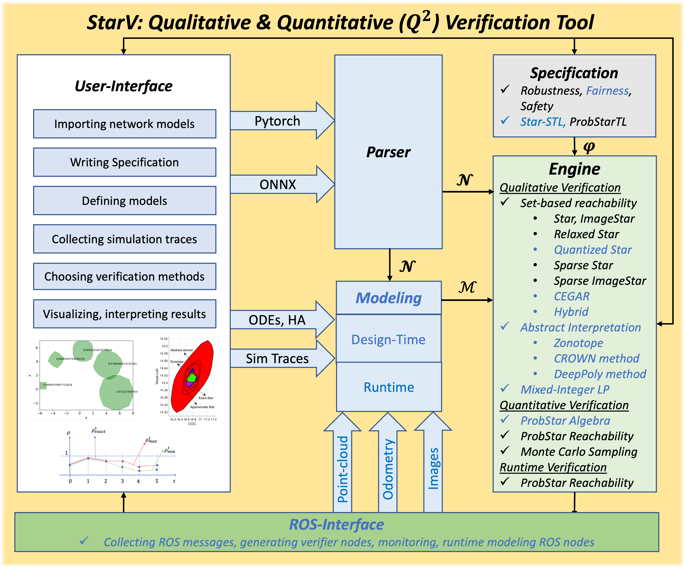

<p align="right">
  <a href="https://github.com/V2A2"></a>
</p>

<div align="center">

# StarV

### Qualitative and Quantitative Verification Tool for Learning-Enabled Systems

[](https://github.com/V2A2/StarV/actions/workflows/ci.yml)
[](https://www.python.org/)
[](./LICENSE)
[](https://github.com/V2A2)

[**Overview**](#overview) •
[**Key Features**](#key-features) •
[**Architecture**](#repository-architecture) •
[**Installation**](#installation) •
[**Quick Start**](#quick-start) •
[**Tests & Tutorials**](#tests--tutorials) •
[**Artifacts**](#reproducibility-artifacts) •
[**Publications**](#publications) •
[**Team**](#developers--contact)

</div>

---

<p align="center">
  <a href="https://github.com/V2A2/StarV"></a>
</p>

## Overview

**StarV** is an open-source Python framework developed by the **Verification and Validation for Learning-Enabled Autonomy (V2A2) Lab** at the **University of Florida** for the formal **qualitative** and **quantitative** verification of deep neural networks (DNNs) and learning-enabled cyber-physical systems (Le-CPS).

Built upon family-of-star symbolic and probabilistic set representations—including **Star**, **ProbStar** (Probabilistic Star), **SparseStar**, **ImageStar**, and **SparseImageStar** (COO/CSR)—StarV enables both worst-case safety verification and exact/bounded probability estimation of complex spatial and temporal specifications.

A detailed user manual is included in the repository root at [`manual.pdf`](./manual.pdf).

---

## Key Features

1. **Rich Symbolic & Probabilistic Set Representations (`StarV/set`)**
   - **`Star`**: Generalized star sets for exact and over-approximate piecewise-linear reachability analysis.
   - **`ProbStar`**: Combines star geometry with multivariate Gaussian distributions to compute exact probabilities of safety satisfaction or violation.
   - **`SparseStar`**: Depth-reduced sparse star representations for deep feedforward and recurrent architectures.
   - **`ImageStar` & `SparseImageStar` (`2DCOO` / `2DCSR`)**: Memory-efficient sparse representations with novel SpGEMM convolution and pooling operations for deep CNNs and semantic segmentation networks.
   - **`Box` & `Zono`**: Interval and zonotope abstractions for fast bound tightening and range estimation.

2. **Broad Neural Network Layer & Activation Coverage (`StarV/layer`, `StarV/fun`)**
   - **Feedforward & Convolutional**: `FullyConnectedLayer`, `Conv2DLayer`, `BatchNorm2DLayer`, `AvgPool2DLayer`, `MaxPool2DLayer`, `FlattenLayer`.
   - **Recurrent Architectures**: `RecurrentLayer` (Vanilla RNN), `LSTMLayer`, `GRULayer`.
   - **Nonlinear Activations**: `PosLin` (`ReLU`), `LeakyReLU`, `SatLin`, `SatLins`, `TanSig` (`Tanh`), `LogSig` (`Sigmoid`), `IdentityX`, `LogX`, `ExpX`, `SqrtX`, `SinX`, `CosX`, and `MixedActivation`.
   - **Model Importers**: Native support for PyTorch, ONNX (`onnx`, `onnx2pytorch`, `onnxruntime`), and MATLAB `.mat` network models.

3. **Closed-Loop Learning-Enabled CPS & Massive Linear Systems (`StarV/plant`, `StarV/nncs`)**
   - Discrete-time and continuous-time linear ODE plants (`DLODE`, `LODE`), Krylov subspace projection methods (Arnoldi/Lanczos) for massive high-dimensional linear systems, and closed-loop neural network control systems (`NNCS`, `AEBS_NNCS`, `DynNN_NNCS`).

4. **Temporal Logic Verification (`StarV/spec`)**
   - **`dProbStarTL` (Discrete-Time Probabilistic Star Temporal Logic)**: Qualitative and quantitative verification of complex bounded temporal behaviors over `ProbStar` reachable traces via Canonical Disjunctive Normal Form (CDNF) realization.
   - **`dStarTL` (Discrete-Time Star Temporal Logic)**: Quantitative robustness interval computation $[\rho_{\phi}^{lb}, \rho_{\phi}^{ub}]$ and predicate-space satisfaction fraction analysis over `Star` reachable traces.

5. **Flexible Solver Backend & Parallel Execution (`StarV/verifier`)**
   - Unified object-oriented [`Verifier`](./StarV/verifier/verifier.py) and [`Certifier`](./StarV/verifier/certifier.py) interfaces with automatic LP solver fallback across **Gurobi** (`gurobipy`), **GLPK** (`glpk`), and **SciPy HiGHS** (`linprog`), enabling zero-license cross-platform execution on Linux and macOS (Intel & Apple Silicon).

---

## Repository Architecture

```text
StarV/
├── StarV/                          # Core library package
│   ├── set/                        # Star, ProbStar, SparseStar, ImageStar, SparseImageStar2DCOO/CSR
│   ├── fun/                        # Activation reachability (PosLin, LeakyReLU, SatLin, TanSig, LogSig, ...)
│   ├── layer/                      # Neural network layers (FC, Conv2D, Pool2D, BatchNorm2D, RNN, LSTM, GRU)
│   ├── net/                        # NeuralNetwork container and BFS/DFS reachability engines
│   ├── plant/                      # LODE and DLODE dynamical system models
│   ├── nncs/                       # Closed-loop NNCS reachability and temporal verification
│   ├── spec/                       # dProbStarTL and dStarTL temporal logic specifications
│   ├── verifier/                   # Verifier and Certifier OOP & functional APIs
│   └── util/                       # Model loaders, plotting utilities, benchmark datasets
├── artifacts/                      # Reproducibility scripts & benchmarks for published papers
├── tests/                          # Unified pytest/unittest test suite and module tests
├── tutorials/                      # Step-by-step tutorials (sets, layers, reachability, verification)
├── .devcontainer/                  # Docker build and launch scripts
├── manual.pdf                      # Comprehensive StarV User Manual
├── pyproject.toml                  # Modern PEP 621 package & pytest configuration
└── requirements.txt                # Core Python dependencies
```

---

## Installation

### Option 1: Conda / Local Environment (Linux & macOS)

StarV supports **Python 3.9 – 3.12** out of the box using SciPy's HiGHS LP solver and multivariate normal CDF routines. Gurobi and GLPK can be installed optionally for accelerated LP solving.

```bash
# 1. Clone the repository
git clone https://github.com/V2A2/StarV.git
cd StarV

# 2. Create and activate a conda environment
conda create -n starv python=3.11 -y
conda activate starv

# 3. Install StarV in editable mode (core dependencies)
pip install -e .

# Optional: Install developer & test tools (pytest)
pip install -e ".[dev]"
```

#### Optional: Installing Gurobi and GLPK Solvers

For large-scale verification benchmarks, we recommend installing **Gurobi** (free academic license available at [Gurobi Academic Program](https://www.gurobi.com/academia/academic-program-and-licenses/)):

```bash
# Install optional solver bindings
# (On Ubuntu, first run: sudo apt-get install libgmp-dev libglpk-dev)
# (On macOS, first run: brew install gmp glpk)
pip install -e ".[solvers]"
```

<details>
<summary><b>Click to expand Gurobi Standalone Setup Instructions on Ubuntu</b></summary>

1. Download and extract Gurobi:
   ```bash
   wget https://packages.gurobi.com/11.0/gurobi11.0.2_linux64.tar.gz
   mkdir -p ~/opt && mv gurobi11.0.2_linux64.tar.gz ~/opt/
   cd ~/opt && tar -xzvf gurobi11.0.2_linux64.tar.gz && rm gurobi11.0.2_linux64.tar.gz
   ```
2. Add the following environment variables to `~/.bashrc` (replace `{PATH_TO_YOUR_HOME}` with your home directory path):
   ```bash
   export GUROBI_HOME="{PATH_TO_YOUR_HOME}/opt/gurobi1102/linux64"
   export GRB_LICENSE_FILE="{PATH_TO_YOUR_HOME}/gurobi.lic"
   export PATH="${PATH}:${GUROBI_HOME}/bin"
   export LD_LIBRARY_PATH="${LD_LIBRARY_PATH}:${GUROBI_HOME}/lib"
   ```
3. Reload `~/.bashrc` (`source ~/.bashrc`) and activate your academic license using `grbgetkey`.
</details>

---

### Option 2: Running with Docker

1. Acquire a Gurobi Web License Service (WLS) license from [Gurobi WLS](https://www.gurobi.com/features/web-license-service/) and place `gurobi.lic` in the root `StarV/` directory.
2. Build and launch the Docker container:

```bash
sh .devcontainer/build_docker.sh
sh .devcontainer/launch_docker.sh
```

---

## Quick Start

### 1. Quantitative Verification of a Neural Network (`ProbStar` + `Verifier`)

```python
import numpy as np
from StarV.set.probstar import ProbStar
from StarV.layer.FullyConnectedLayer import FullyConnectedLayer
from StarV.layer.ReLULayer import ReLULayer
from StarV.net.network import NeuralNetwork
from StarV.verifier.verifier import Verifier

# Construct a 2-input, 2-output ReLU network
W = np.array([[1.0, -0.5], [0.5, 1.0]])
b = np.array([0.0, 0.1])
net = NeuralNetwork([FullyConnectedLayer([W, b]), ReLULayer()], net_type='ffnn')

# Define a Gaussian input distribution with bounded support [-1, 1]^2
mu = np.array([0.0, 0.0])
Sig = np.eye(2)
lb = np.array([-1.0, -1.0])
ub = np.array([1.0, 1.0])
input_probstar = ProbStar(mu, Sig, lb, ub)

# Define an unsafe region: y_0 <= -0.1 (unreachable after ReLU)
unsafe_mat = np.array([[1.0, 0.0]])
unsafe_vec = np.array([-0.1])

verifier = Verifier(lp_solver='linprog', n_processes=1)
res, CounterExamples, CEX_prob, p_filters = verifier.verify(
    net, input_probstar, unsafe_mat=unsafe_mat, unsafe_vec=unsafe_vec
)
print("Verification result:", res, "| Counterexample probability:", CEX_prob)
```

### 2. Robustness Certification (`SparseStar` + `Certifier`)

```python
import numpy as np
from StarV.set.sparsestar import SparseStar
from StarV.verifier.certifier import Certifier

certifier = Certifier(lp_solver='linprog', method='BFS', reachMethod='approx', n_processes=1)
input_set = SparseStar(np.array([0.8, 0.1]), np.array([0.9, 0.2]))
rb, vt, vt_total, Y = certifier.certify(net, input_set, labels=0, show=False)
print(f"Certified robust: {rb == 1} (verification time: {vt_total:.4f}s)")
```

### 3. Temporal Logic Specification (`dStarTL`)

```python
import numpy as np
from StarV.set.star import Star
from StarV.spec import dStarTL

# Specify Always_[0, 1] (x_0 <= 0.5)
ap = dStarTL.AtomicPredicate(np.array([1.0, 0.0]), np.array([0.5]))
spec = dStarTL.Formula([
    dStarTL._ALWAYS_(0, 1), dStarTL._LeftBracket_(), ap, dStarTL._RightBracket_()
])
expanded = dStarTL.ExpandedFormula(spec)

trace = [
    Star(np.array([-0.2, -0.2]), np.array([0.2, 0.2])),
    Star(np.array([-0.1, -0.1]), np.array([0.3, 0.3])),
]
rho_lb, rho_ub = dStarTL.GetRobustnessInterval(trace, lp_solver='linprog').getRobustnessInterval(expanded)
print(f"Robustness interval: [{rho_lb:.4f}, {rho_ub:.4f}]")
```

---

## Tests & Tutorials

### Running the Test Suite

You can run the unified test suite via `pytest` or Python's built-in `unittest`:

```bash
# Run the full unified test suite
pytest

# Or using unittest directly
python3 -m unittest tests/test_suite.py -v

# Run an individual module test script
python3 tests/test_set_probstar.py
```

### Running Tutorials

Interactive tutorial scripts matching [`manual.pdf`](./manual.pdf) are organized under [`tutorials/`](./tutorials):

- [`tutorials/reachable_sets/`](./tutorials/reachable_sets) — `Star`, `ProbStar`, `SparseStar`, `ImageStar`, and `SparseImageStar` basics
- [`tutorials/layers/`](./tutorials/layers) — Layer-by-layer reachability propagation
- [`tutorials/reachability_analysis/`](./tutorials/reachability_analysis) — Exact and approximate network reachability
- [`tutorials/verification/`](./tutorials/verification) — Safety verification and robustness certification

```bash
python3 tutorials/reachable_sets/tutorial_star.py
```

---

## Reproducibility Artifacts

The [`artifacts/`](./artifacts) directory contains experimental benchmarks and evaluation scripts for our published and ongoing papers:

| Artifact Directory | Associated Paper / Topic |
| :--- | :--- |
| [`artifacts/CAV2025_StarV_Tool`](./artifacts/CAV2025_StarV_Tool) | **CAV 2025**: *StarV: A Qualitative and Quantitative Verification Tool for Learning-Enabled Systems* |
| [`artifacts/HSCC2025_ProbStarTL`](./artifacts/HSCC2025_ProbStarTL) | **HSCC 2025**: *ProbStar Temporal Logic for Verifying Complex Behaviors of Learning-enabled Systems* |
| [`artifacts/ICFEM2025_Masssive_LS_ProbStarTL`](./artifacts/ICFEM2025_Masssive_LS_ProbStarTL) | **ICFEM 2025**: *Quantitative Verification for Temporal Properties of Massive Linear Systems* |
| [`artifacts/NeurIPS2025_SparseImageStar`](./artifacts/NeurIPS2025_SparseImageStar) | **SparseImageStar**: *Memory-Efficient Verification for Deep Convolutional Neural Networks using SparseImageStar* |
| [`artifacts/NAHS2024_RNN`](./artifacts/NAHS2024_RNN) | **NAHS 2025**: *Reachability Analysis of Recurrent Neural Networks* |
| [`artifacts/NAHS2024_LeCPS`](./artifacts/NAHS2024_LeCPS) | **NAHS 2026**: *Quantitative Verification of Learning-enabled Systems using ProbStar Reachability* |
| [`artifacts/TACAS2026_RNN`](./artifacts/TACAS2026_RNN) | **TACAS 2026**: ProbStar reachability and temporal verification of RNNs on CMAPSS & LIMO benchmarks |
| [`artifacts/FSE2027_StarTL`](./artifacts/FSE2027_StarTL) | **StarTL**: Quantitative robustness intervals & satisfaction fractions for ACC, AEBS, CMAPSS, and LIMO |
| [`artifacts/HSCC2023_ProbStar`](./artifacts/HSCC2023_ProbStar) | **HSCC 2023**: *Quantitative Verification for Neural Networks using ProbStars* |

---

## Publications

For a complete, continuously updated list of publications from our group, please visit [**Dr. Hoang-Dung Tran's Google Scholar Profile**](https://scholar.google.com/citations?user=_RzS3uMAAAAJ&hl=en).

### 2025 – 2026 (Recent Highlights)

- **[NAHS 2026] ProbStar Le-CPS** — Yuntao Li, Sung Woo Choi, Qing Liu, Hideki Okamoto, Bardh Hoxha, Georgios Fainekos, and Hoang-Dung Tran, *"Quantitative Verification of Learning-enabled Systems using ProbStar Reachability,"* **Nonlinear Analysis: Hybrid Systems**, Vol. 59, 101623, 2026. [[DOI](https://doi.org/10.1016/j.nahs.2025.101623)]
- **[arXiv 2026] Deterministic World Models** — Yuang Geng, Zhongzheng Zhang, Chengzhen Jiang, Yanru Li, Xinyang Wang, Zhuoyang Zhou, Hoang-Dung Tran, and Ivan Ruchkin, *"Deterministic World Models for Closed-loop Reachability Analysis of End-to-End Vision-based Control,"* **arXiv:2512.08991**, 2026. [[arXiv](https://arxiv.org/abs/2512.08991)]
- **[CAV 2025] StarV Tool** — Hoang-Dung Tran, Sung Woo Choi, Yuntao Li, Qing Liu, Hideki Okamoto, Bardh Hoxha, and Georgios Fainekos, *"StarV: A Qualitative and Quantitative Verification Tool for Learning-Enabled Systems,"* **37th International Conference on Computer Aided Verification (CAV)**, pp. 376–394, 2025. [[Springer](https://link.springer.com/chapter/10.1007/978-3-031-98679-6_17)]
- **[HSCC 2025] ProbStarTL** — Hoang-Dung Tran, Sung Woo Choi, Yuntao Li, Hideki Okamoto, Bardh Hoxha, and Georgios Fainekos, *"ProbStar Temporal Logic for Verifying Complex Behaviors of Learning-enabled Systems,"* **28th ACM International Conference on Hybrid Systems: Computation and Control (HSCC)**, pp. 1–12, 2025. [[ACM DL](https://dl.acm.org/doi/10.1145/3716863.3718035)]
- **[ICFEM 2025] Massive Linear Systems** — Qing Liu, Yuntao Li, Sung Woo Choi, Luan Viet Nguyen, and Hoang-Dung Tran, *"Quantitative Verification for Temporal Properties of Massive Linear Systems,"* **26th International Conference on Formal Engineering Methods (ICFEM)**, LNCS Vol. 16229, pp. 305–328, 2025.
- **[ICCPS 2025] Perception-based Runtime Verification** — Ryan Brown, Luan Viet Nguyen, Weiming Xiang, Marilyn Wolf, and Hoang-Dung Tran, *"Perception-based Quantitative Runtime Verification for Learning-enabled Cyber-Physical Systems,"* **ACM/IEEE 16th International Conference on Cyber-Physical Systems (ICCPS)**, pp. 4:1–4:11, 2025. [[DOI](https://doi.org/10.1145/3716550.3722031)]
- **[NAHS 2025] SparseStar LSTM & GRU** — Sung Woo Choi, Yuntao Li, Xiaodong Yang, Tomoya Yamaguchi, Bardh Hoxha, Georgios Fainekos, Danil Prokhorov, and Hoang-Dung Tran, *"Reachability Analysis of Recurrent Neural Networks,"* **Nonlinear Analysis: Hybrid Systems**, Vol. 56, 101581, 2025. [[DOI](https://doi.org/10.1016/j.nahs.2025.101581)]
- **[ACM TECS 2025] Sigmoidal Neural Networks** — Sung Woo Choi, Michael Ivashchenko, Luan V. Nguyen, and Hoang-Dung Tran, *"Reachability Analysis of Sigmoidal Neural Networks,"* **ACM Transactions on Embedded Computing Systems (TECS)**, Vol. 24, No. 3, pp. 1–25, 2025. [[ACM DL](https://dl.acm.org/doi/10.1145/3627991)]

### 2019 – 2024 (Foundational & Related Works)

- **[MEMOCODE 2024] Human-Robot Construction Verification** *(Best Paper Award Runner-Up)* — Apala Pramanik, Sung Woo Choi, Yuntao Li, Luan Viet Nguyen, Kyungki Kim, and Hoang-Dung Tran, *"Perception-based Runtime Monitoring and Verification for Human-Robot Construction Systems,"* **22nd ACM-IEEE International Symposium on Formal Methods and Models for System Design (MEMOCODE)**, pp. 124–134, 2024. [[DOI](https://doi.org/10.1109/MEMOCODE63347.2024.00004)]
- **[HSCC 2023] ProbStar** — Hoang-Dung Tran, Sung Woo Choi, Hideki Okamoto, Bardh Hoxha, Georgios Fainekos, and Danil Prokhorov, *"Quantitative Verification for Neural Networks using ProbStars,"* **26th ACM International Conference on Hybrid Systems: Computation and Control (HSCC)**, pp. 1–12, 2023. [[ACM DL](https://dl.acm.org/doi/10.1145/3575870.3587112)]
- **[HSCC 2023] Star RNN** — Hoang-Dung Tran, Sung Woo Choi, Xiaodong Yang, Tomoya Yamaguchi, Bardh Hoxha, and Danil Prokhorov, *"Verification of Recurrent Neural Networks with Star Reachability,"* **26th ACM International Conference on Hybrid Systems: Computation and Control (HSCC)**, pp. 1–13, 2023. [[ACM DL](https://dl.acm.org/doi/10.1145/3575870.3587128)]
- **[CAV 2023] NNV 2.0** — Diego Manzanas Lopez, Sung Woo Choi, Hoang-Dung Tran, and Taylor T. Johnson, *"NNV 2.0: The Neural Network Verification Tool,"* **35th International Conference on Computer Aided Verification (CAV)**, pp. 397–412, 2023. [[DOI](https://doi.org/10.1007/978-3-031-37703-7_19)]
- **[CAV 2021] ImageStar SSNN** — Hoang-Dung Tran, Neelanjana Pal, Patrick Musau, Diego Manzanas Lopez, Nathaniel Hamilton, Xiaodong Yang, Stanley Bak, and Taylor T. Johnson, *"Robustness Verification of Semantic Segmentation Neural Networks using Relaxed Reachability,"* **33rd International Conference on Computer Aided Verification (CAV)**, pp. 263–286, 2021. [[DOI](https://doi.org/10.1007/978-3-030-81685-8_12)]
- **[CAV 2020] ImageStar** — Hoang-Dung Tran, Stanley Bak, Weiming Xiang, and Taylor T. Johnson, *"Verification of Deep Convolutional Neural Networks using ImageStars,"* **32nd International Conference on Computer Aided Verification (CAV)**, pp. 18–42, 2020. [[DOI](https://doi.org/10.1007/978-3-030-53288-8_2)]
- **[FM 2019] Star** — Hoang-Dung Tran, Diego Manzanas Lopez, Patrick Musau, Xiaodong Yang, Luan Viet Nguyen, Weiming Xiang, and Taylor T. Johnson, *"Star-Based Reachability Analysis of Deep Neural Networks,"* **International Symposium on Formal Methods (FM)**, pp. 670–686, 2019. [[DOI](https://doi.org/10.1007/978-3-030-30942-8_39)]

### Citation (BibTeX)

If you use **StarV** in your research, please cite our CAV 2025 tool paper and relevant methodological papers:

```bibtex
@inproceedings{tran2025starv,
  title={StarV: A Qualitative and Quantitative Verification Tool for Learning-Enabled Systems},
  author={Tran, Hoang-Dung and Choi, Sung Woo and Li, Yuntao and Liu, Qing and Okamoto, Hideki and Hoxha, Bardh and Fainekos, Georgios},
  booktitle={International Conference on Computer Aided Verification (CAV)},
  pages={376--394},
  year={2025},
  organization={Springer}
}

@article{li2026quantitative,
  title={Quantitative Verification of Learning-enabled Systems using ProbStar Reachability},
  author={Li, Yuntao and Choi, Sung Woo and Liu, Qing and Okamoto, Hideki and Hoxha, Bardh and Fainekos, Georgios and Tran, Hoang-Dung},
  journal={Nonlinear Analysis: Hybrid Systems},
  volume={59},
  pages={101623},
  year={2026},
  publisher={Elsevier}
}

@inproceedings{tran2025probstar,
  title={ProbStar Temporal Logic for Verifying Complex Behaviors of Learning-enabled Systems},
  author={Tran, Hoang-Dung and Choi, Sung Woo and Li, Yuntao and Okamoto, Hideki and Hoxha, Bardh and Fainekos, Georgios},
  booktitle={Proceedings of the 28th ACM International Conference on Hybrid Systems: Computation and Control (HSCC)},
  pages={1--12},
  year={2025}
}

@inproceedings{liu2025quantitative,
  title={Quantitative Verification for Temporal Properties of Massive Linear Systems},
  author={Liu, Qing and Li, Yuntao and Choi, Sung Woo and Nguyen, Luan Viet and Tran, Hoang-Dung},
  booktitle={International Conference on Formal Engineering Methods (ICFEM)},
  series={Lecture Notes in Computer Science},
  volume={16229},
  pages={305--328},
  year={2025},
  organization={Springer}
}

@inproceedings{brown2025perception,
  title={Perception-based Quantitative Runtime Verification for Learning-enabled Cyber-Physical Systems},
  author={Brown, Ryan and Nguyen, Luan Viet and Xiang, Weiming and Wolf, Marilyn and Tran, Hoang-Dung},
  booktitle={Proceedings of the ACM/IEEE 16th International Conference on Cyber-Physical Systems (ICCPS)},
  pages={1--11},
  year={2025}
}

@article{choi2025reachability,
  title={Reachability analysis of recurrent neural networks},
  author={Choi, Sung Woo and Li, Yuntao and Yang, Xiaodong and Yamaguchi, Tomoya and Hoxha, Bardh and Fainekos, Georgios and Prokhorov, Danil and Tran, Hoang-Dung},
  journal={Nonlinear Analysis: Hybrid Systems},
  volume={56},
  pages={101581},
  year={2025},
  publisher={Elsevier}
}

@article{choi2025sigmoidal,
  title={Reachability analysis of sigmoidal neural networks},
  author={Choi, Sung Woo and Ivashchenko, Michael and Nguyen, Luan V and Tran, Hoang-Dung},
  journal={ACM Transactions on Embedded Computing Systems (TECS)},
  volume={24},
  number={3},
  pages={1--25},
  year={2025},
  publisher={ACM}
}

@inproceedings{pramanik2024perception,
  title={Perception-based Runtime Monitoring and Verification for Human-Robot Construction Systems},
  author={Pramanik, Apala and Choi, Sung Woo and Li, Yuntao and Nguyen, Luan Viet and Kim, Kyungki and Tran, Hoang-Dung},
  booktitle={22nd ACM-IEEE International Symposium on Formal Methods and Models for System Design (MEMOCODE)},
  pages={124--134},
  year={2024}
}

@inproceedings{tran2023quantitative,
  title={Quantitative verification for neural networks using probstars},
  author={Tran, Hoang-Dung and Choi, Sung Woo and Okamoto, Hideki and Hoxha, Bardh and Fainekos, Georgios and Prokhorov, Danil},
  booktitle={Proceedings of the 26th ACM International Conference on Hybrid Systems: Computation and Control (HSCC)},
  pages={1--12},
  year={2023}
}

@inproceedings{tran2023verification,
  title={Verification of recurrent neural networks with star reachability},
  author={Tran, Hoang-Dung and Choi, Sung Woo and Yang, Xiaodong and Yamaguchi, Tomoya and Hoxha, Bardh and Prokhorov, Danil},
  booktitle={Proceedings of the 26th ACM International Conference on Hybrid Systems: Computation and Control (HSCC)},
  pages={1--13},
  year={2023}
}

@inproceedings{tran2021robustness,
  title={Robustness verification of semantic segmentation neural networks using relaxed reachability},
  author={Tran, Hoang-Dung and Pal, Neelanjana and Musau, Patrick and Lopez, Diego Manzanas and Hamilton, Nathaniel and Yang, Xiaodong and Bak, Stanley and Johnson, Taylor T},
  booktitle={International Conference on Computer Aided Verification (CAV)},
  pages={263--286},
  year={2021},
  organization={Springer}
}

@inproceedings{tran2020verification,
  title={Verification of deep convolutional neural networks using imagestars},
  author={Tran, Hoang-Dung and Bak, Stanley and Xiang, Weiming and Johnson, Taylor T},
  booktitle={International Conference on Computer Aided Verification (CAV)},
  pages={18--42},
  year={2020},
  organization={Springer}
}

@inproceedings{tran2019star,
  title={Star-based reachability analysis of deep neural networks},
  author={Tran, Hoang-Dung and Manzanas Lopez, Diego and Musau, Patrick and Yang, Xiaodong and Nguyen, Luan Viet and Xiang, Weiming and Johnson, Taylor T},
  booktitle={International Symposium on Formal Methods (FM)},
  pages={670--686},
  year={2019},
  organization={Springer}
}
```

---

## Developers & Contact

StarV is developed and maintained by the **V2A2 Lab** in the Department of Computer & Information Science & Engineering (CISE) at the **University of Florida**:

- **Hoang-Dung Tran** ([dungtran@ufl.edu](mailto:dungtran@ufl.edu)), University of Florida *(Principal Investigator)*
- **Sung Woo Choi** ([sungwoo.choi@ufl.edu](mailto:sungwoo.choi@ufl.edu)), University of Florida
- **Yuntao Li** ([yli17@ufl.edu](mailto:yli17@ufl.edu)), University of Florida
- **Qing Liu** ([qliu1@ufl.edu](mailto:qliu1@ufl.edu)), University of Florida

## License

This project is licensed under the **BSD 3-Clause License** — see the [`LICENSE`](./LICENSE) file for details.
