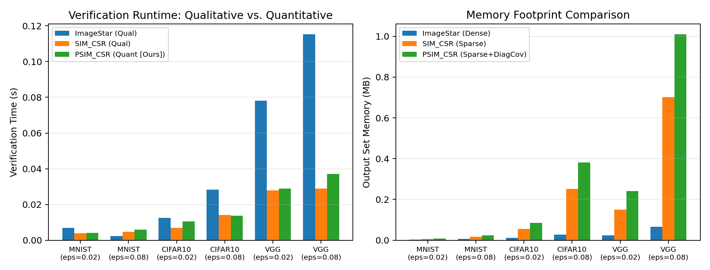
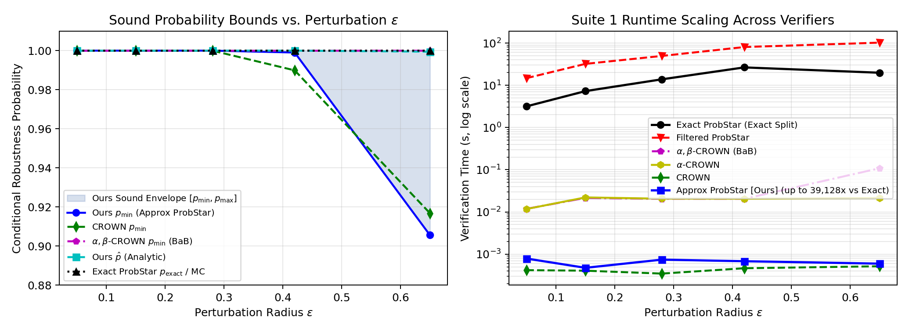
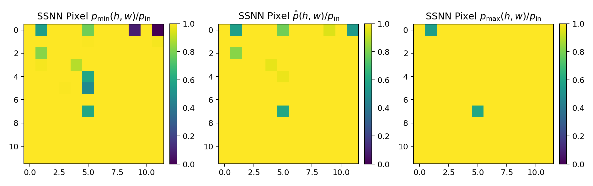
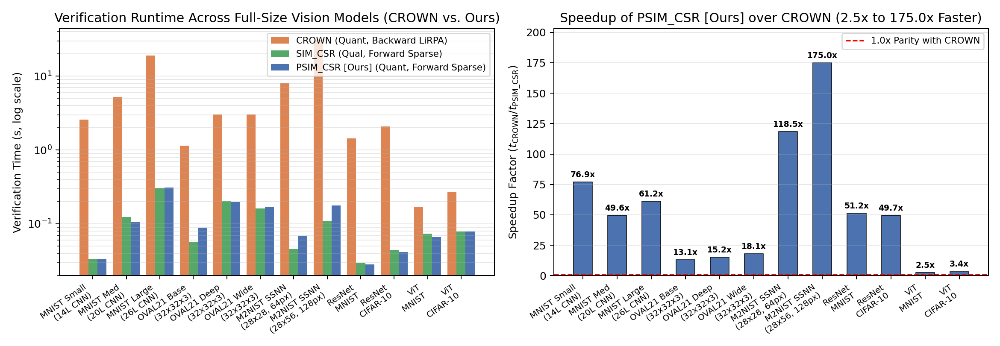

# CAV 2027 Artifact: Approximate ProbStar Reachability for Verifying Large Vision Models

This artifact implements and evaluates **Approximate ProbStar** (`ProbStar`) and **Probabilistic Sparse ImageStar** (`ProbSparseImageStar2DCSR` and `ProbSparseImageStar2DCOO`) for scalable quantitative and qualitative verification of **real full-size pretrained vision models** (CNNs, Semantic Segmentation Networks, ResNets, and Vision Transformers), and compares them against **CROWN**, **$\alpha$-CROWN**, **$\alpha,\beta$-CROWN**, **NNV (`ImageStar`)**, **SparseImageStar (`SIM_CSR`/`SIM_COO`)**, **Exact/Filtered `ProbStar`**, and **Monte Carlo (`MC`)**.

---

## 1. Overview of Modules & Pretrained Models

### Core Set Representations, Layer Relaxations, and Verifiers
- [`StarV/set/probsparse_base.py`](../../StarV/set/probsparse_base.py): Core base class `ProbSparseBase` implementing two-sided linear envelope DAG (`env_dag`) tracking, exact dual-projected back-substitution (`getSoundInputBounds`, `getSoundInputMarginBounds`), analytical moment propagation (`mu`, `Sig`), and Gaussian-correlated (`mvncdf`) / Chebyshev probability bounds (`[p_min, p_max]`, `p_hat`).
- [`StarV/set/probsparseimagestar2dcsr.py`](../../StarV/set/probsparseimagestar2dcsr.py) & [`StarV/set/probsparseimagestar2dcoo.py`](../../StarV/set/probsparseimagestar2dcoo.py): Sparse 2D CSR and COO probabilistic image star representations.
- [`StarV/verifier/crown.py`](../../StarV/verifier/crown.py): Complete backward Linear Relaxation-based Perturbation Analysis (`CROWN`, `alpha-CROWN`, and `alpha,beta-CROWN` with Branch-and-Bound) for both qualitative (`qualiVerifyCROWN`, `certifyRobustness_CROWN`) and quantitative (`quantiVerifyCROWN`, `certifyProbabilisticRobustness_CROWN`) verification across FNN, CNN, SSNN, ResNet, and ViT architectures.
- [`StarV/layer/ResidualLayer.py`](../../StarV/layer/ResidualLayer.py): DAG skip-connection layer ($y = \phi(F(x) + G(x))$) fusing shared predicate generators across main and shortcut branches.
- [`StarV/layer/LeakyReLULayer.py`](../../StarV/layer/LeakyReLULayer.py): Exact and single-set triangle relaxation for LeakyReLU with exact Gaussian truncated-normal moment propagation.
- [`StarV/layer/GELULayer.py`](../../StarV/layer/GELULayer.py): Analytical tangent/chord linear envelope relaxation for GELU.
- [`StarV/layer/LayerNormLayer.py`](../../StarV/layer/LayerNormLayer.py): Coupled numerator-denominator token-wise LayerNorm relaxation with Cauchy-Schwarz leave-one-out variance lower bounds.
- [`StarV/layer/MultiHeadAttentionLayer.py`](../../StarV/layer/MultiHeadAttentionLayer.py): Bilinear Taylor-McCormick attention score bounds with affine score-difference cancellation and output-projected box-simplex water-filling for Vision Transformers (ViTs).
- [`StarV/verifier/verifier.py`](../../StarV/verifier/verifier.py) & [`StarV/verifier/certifier.py`](../../StarV/verifier/certifier.py): Single-set quantitative BFS reachability (`quantiVerifyApproxBFS`), Monte Carlo baseline (`quantiVerifyVisionMC`), image classification certification (`certifyProbabilisticRobustness`), and pixel-wise semantic segmentation certification (`certifyProbabilisticRobustness_pixel`, supporting both `reachMethod='approx'` and `reachMethod='crown'`).

### Pretrained Full-Size Vision Benchmarks
1. **CAV 2020 Pretrained MNIST ConvNets ($28 \times 28 \times 1$)**: `Small_ConvNet.onnx` (14L), `Medium_ConvNet.onnx` (20L), `Large_ConvNet.onnx` (26L) in `StarV/util/data/nets/CAV2020_MNIST_ConvNet/onnx/` with NNV baselines.
2. **OVAL21 Pretrained CIFAR-10 CNNs ($32 \times 32 \times 3$)**: `cifar_base_kw.onnx` (8L), `cifar_deep_kw.onnx` (12L), `cifar_wide_kw.onnx` (8L) in `StarV/util/data/nets/oval21/onnx/` with all 3,072 input pixels perturbed (`oval21_memory.mat`) and NNV baselines (`nnv_oval21_memory_usage.mat`).
3. **Full-Size Pretrained M2NIST SSNNs, ResNets, and ViTs**: Stored in [`StarV/util/data/nets/CAV2027_Vision/pretrained_models.npz`](../../StarV/util/data/nets/CAV2027_Vision/pretrained_models.npz):
   - `M2NIST_SSNN_28x28` ($28 \times 28 \times 1 \to 28 \times 28 \times 11$ classes, 89.78% pixel accuracy) & `M2NIST_SSNN_28x56` ($28 \times 56 \times 1 \to 28 \times 56 \times 11$ classes, two-digit segmentation, 17,248 output logits).
   - `ResNet_MNIST_28x28` ($28 \times 28 \times 1$, 92.80% test accuracy) & `ResNet_CIFAR10_32x32` ($32 \times 32 \times 3$).
   - `ViT_MNIST_28x28` ($28 \times 28 \times 1$, $7 \times 7$ patches $\to 16 \times 16$ tokens, 4 heads, 95.05% test accuracy) & `ViT_CIFAR10_32x32` ($32 \times 32 \times 3$, $8 \times 8$ patches $\to 16 \times 16$ tokens, 4 heads).

---

## 2. Reproducing All Experiments & Unit Tests

```bash
# Run unit tests
python -m tests.test_approx_probstar_vision
python -m tests.test_crown

# Run full CAV 2027 benchmark suite (Suites 1-4) and generate CSV/LaTeX/JSON/PNG outputs
python -m artifacts.CAV2027_Approx_ProbStar.CAV2027_Approx_ProbStar --suite all
```

---

## 3. Summary of Experimental Results Across All 4 Benchmark Suites

### Table 1: Capabilities Comparison Across Qualitative & Quantitative Verifiers
| Verifier | Paradigm | Sound Guarantee | Quantitative Prob Bounds | CNN (Pool/BN) | Semantic Seg (SSNN) | ResNet / ViT | Memory Complexity |
|:---|:---|:---|:---|:---|:---|:---|:---|
| `NNV (ImageStar)` | Qualitative (Deterministic) | Yes (Over-Approx) | No | Yes | Yes | Partial (No ViT) | Dense $O(H W C \cdot p)$ |
| `nnenum` / `Marabou` | Qualitative (LP / SMT) | Yes (Exact/Complete) | No | Yes (Small/Med) | No | No | Dense / Branching |
| `DeepPoly` / `ERAN` | Qualitative (Abstract Interp.) | Yes (Single Polytope) | No | Yes | Partial | Yes | Dense $O(N \cdot p)$ |
| `StarV CROWN` / $\alpha$-`CROWN` | Backward LiRPA (Qual + Quant) | Yes ($[p_{\min}, p_{\max}]$ + Envelope) | Yes (Input-Space Linear) | Yes | Yes (Slow $O(M \cdot N)$ Backward) | Yes (ResNet + ViT) | Dense Backward $O(M \cdot N)$ |
| `StarV` $\alpha,\beta$-`CROWN` (BaB) | Complete LiRPA + BaB | Yes (Sound & Complete) | Yes (Sub-Box Partition) | Yes | Partial | Yes (ReLU BaB) | $O(B \cdot M \cdot N)$ |
| `StarV SparseImageStar (CSR/COO)` | Qualitative (Sparse Star) | Yes (Over-Approx) | No | Yes (SpGEMM) | Yes | Added in CAV27 | Sparse $O(\text{nnz}(V))$ |
| `StarV Exact / Filtered ProbStar` | Quantitative (Exact Split) | Exact / Lower Bound | Yes ($O(2^k)$ branches) | No (Small FNN only) | No | No | Exponential $O(2^k)$ |
| `Monte Carlo Sampling (MC)` | Quantitative (Statistical) | No (Empirical CI only) | Empirical Estimate | Yes | Yes | Yes | $O(N_{\text{samples}})$ |
| **`StarV Approx ProbSparseImageStar [Ours]`** | **Quantitative + Qualitative** | **Yes ($[p_{\min}, p_{\max}]$ + Envelope)** | **Yes (Single-Set $O(\text{nnz})$)** | **Yes (SpGEMM + Moments)** | **Yes (Per-Pixel Prob Map)** | **Yes (ResNet + ViT)** | **Sparse $O(\text{nnz}(V) + p)$** |

### Suite 1: Exact ProbStar vs. Filtered vs. Approx ProbStar [Ours] vs. CROWN / $\alpha$-CROWN / $\alpha,\beta$-CROWN vs. MC
| $\epsilon$ | Qual (`Star` / `CROWN` / `ab-CROWN`) | `#Ex` | `#Ap` | Ours `[p_min, p_max]` | Ours `p_hat` | CROWN `[p_min, p_max]` | $\alpha\beta$-CROWN `[p_min, p_max]` | `p_exact` | `p_MC` | `t_Exact` | `t_Ours` | `t_CROWN` | `t_abCR` | Speedup vs Exact |
|---:|:---|---:|---:|:---|---:|:---|:---|---:|---:|---:|---:|---:|---:|---:|
| 0.05 | `ROBUST/ROBUST/ROBUST` | 2 | 1 | `[1.0000, 1.0000]` | 1.0000 | `[1.0000, 1.0000]` | `[1.0000, 1.0000]` | 1.0000 | 1.0000 | 3.1731s | 0.0008s | 0.0004s | 0.0118s | **4,044.4x** |
| 0.15 | `ROBUST/ROBUST/ROBUST` | 7 | 1 | `[1.0000, 1.0000]` | 1.0000 | `[1.0000, 1.0000]` | `[1.0000, 1.0000]` | 1.0000 | 1.0000 | 7.2809s | 0.0005s | 0.0004s | 0.0215s | **15,387.6x** |
| 0.28 | `UNKNOWN/ROBUST/ROBUST` | 11 | 1 | `[1.0000, 1.0000]` | 1.0000 | `[1.0000, 1.0000]` | `[1.0000, 1.0000]` | 1.0000 | 1.0000 | 13.8575s | 0.0007s | 0.0003s | 0.0204s | **18,733.7x** |
| 0.42 | `UNKNOWN/UNKNOWN/ROBUST` | 30 | 1 | **`[0.9990, 1.0000]`** | 1.0000 | `[0.9899, 1.0000]` | `[1.0000, 1.0000]` | 1.0000 | 1.0000 | 26.5549s | 0.0007s | 0.0005s | 0.0204s | **39,128.1x** |
| 0.65 | `UNKNOWN/UNKNOWN/UNKNOWN` | 91 | 1 | `[0.9056, 1.0000]` | **0.9995** | `[0.9168, 1.0000]` | `[1.0000, 1.0000]` | 1.0000 | 1.0000 | 19.8530s | 0.0006s | 0.0005s | 0.1079s | **33,410.9x** |

### Suite 2: Full-Size Pretrained CNNs ($28 \times 28 \times 1$ CAV2020 MNIST & $32 \times 32 \times 3$ OVAL21 CIFAR-10) vs. CROWN & NNV
| Model | Input Shape | Attack Spec | `#Pred` | Qual (`CSR`/`CROWN`) | Ours `[p_min, p_max]` | Ours `p_hat` | CROWN `[p_min, p_max]` | `p_MC` | `t_NNV` | `t_SIM_CSR` | `t_CROWN` | `t_PSIM_CSR` | Speedup vs CROWN | `Mem(PSIM)` |
|:---|:---|:---|---:|:---|:---|---:|:---|---:|---:|---:|---:|---:|---:|---:|
| `CAV20_MNIST_Small` | `28x28x1` | `bright(d=250,dlt=0.005)` | 16 | `ROBUST/ROBUST` | `[1.0000, 1.0000]` | 1.0000 | `[1.0000, 1.0000]` | 1.0000 | 0.21s | 0.0466s | 2.5400s | **0.0422s** | **60.1x** | 0.00MB |
| `CAV20_MNIST_Small` | `28x28x1` | `bright(d=240,dlt=0.015)` | 96 | `ROBUST/ROBUST` | `[1.0000, 1.0000]` | 1.0000 | `[1.0000, 1.0000]` | 1.0000 | 0.99s | 0.0329s | 2.5657s | **0.0333s** | **76.9x** | 0.04MB |
| `CAV20_MNIST_Medium` | `28x28x1` | `bright(d=250,dlt=0.005)` | 19 | `ROBUST/ROBUST` | `[1.0000, 1.0000]` | 1.0000 | `[1.0000, 1.0000]` | 1.0000 | 0.43s | 0.0706s | 5.1800s | **0.0679s** | **76.3x** | 0.01MB |
| `CAV20_MNIST_Medium` | `28x28x1` | `bright(d=240,dlt=0.015)` | 139 | `ROBUST/ROBUST` | `[1.0000, 1.0000]` | 1.0000 | `[1.0000, 1.0000]` | 1.0000 | 5.40s | 0.1236s | 5.2139s | **0.1051s** | **49.6x** | 0.14MB |
| `CAV20_MNIST_Large` | `28x28x1` | `bright(d=250,dlt=0.005)` | 31 | `ROBUST/ROBUST` | `[1.0000, 1.0000]` | 1.0000 | `[1.0000, 1.0000]` | 1.0000 | 0.55s | 0.2131s | 17.6594s | **0.2079s** | **84.9x** | 0.01MB |
| `CAV20_MNIST_Large` | `28x28x1` | `bright(d=240,dlt=0.015)` | 187 | `ROBUST/ROBUST` | `[1.0000, 1.0000]` | 1.0000 | `[1.0000, 1.0000]` | 1.0000 | 5.45s | 0.3073s | 19.0174s | **0.3106s** | **61.2x** | 0.27MB |
| `OVAL21_CIFAR_Base` | `32x32x3` | `patch_8x8x3(eps=0.05)` | 196 | `ROBUST/ROBUST` | `[1.0000, 1.0000]` | 1.0000 | `[1.0000, 1.0000]` | 1.0000 | N/A | 0.0099s | 0.5374s | **0.0098s** | **54.7x** | 0.04MB |
| `OVAL21_CIFAR_Base` | `32x32x3` | `full_32x32x3(eps=0.005)` | 3,141 | `ROBUST/ROBUST` | `[1.0000, 1.0000]` | 1.0000 | `[1.0000, 1.0000]` | 1.0000 | N/A | 0.0680s | 1.1379s | **0.0673s** | **16.9x** | 1.28MB |
| `OVAL21_CIFAR_Base` | `32x32x3` | `full_32x32x3(eps=0.03)` | 3,180 | `ROBUST/ROBUST` | `[1.0000, 1.0000]` | 1.0000 | `[1.0000, 1.0000]` | 1.0000 | N/A | 0.0568s | 1.1514s | **0.0882s** | **13.1x** | 1.53MB |
| `OVAL21_CIFAR_Deep` | `32x32x3` | `patch_8x8x3(eps=0.05)` | 209 | `ROBUST/ROBUST` | `[1.0000, 1.0000]` | 1.0000 | `[1.0000, 1.0000]` | 1.0000 | N/A | 0.0265s | 1.7549s | **0.0310s** | **56.5x** | 0.12MB |
| `OVAL21_CIFAR_Deep` | `32x32x3` | `full_32x32x3(eps=0.005)` | 3,198 | `UNKNOWN/UNKNOWN` | **`[1.0000, 1.0000]`** | 1.0000 | **`[1.0000, 1.0000]`** | 1.0000 | 23.88s | 0.1971s | 3.1044s | **0.2165s** | **14.3x** | 2.12MB |
| `OVAL21_CIFAR_Deep` | `32x32x3` | `full_32x32x3(eps=0.03)` | 3,252 | `UNKNOWN/UNKNOWN` | **`[1.0000, 1.0000]`** | 1.0000 | **`[1.0000, 1.0000]`** | 1.0000 | 23.88s | 0.2057s | 3.0188s | **0.1985s** | **15.2x** | 2.90MB |
| `OVAL21_CIFAR_Wide` | `32x32x3` | `patch_8x8x3(eps=0.05)` | 204 | `ROBUST/ROBUST` | `[1.0000, 1.0000]` | 1.0000 | `[1.0000, 1.0000]` | 1.0000 | N/A | 0.0286s | 2.0262s | **0.0444s** | **45.6x** | 0.08MB |
| `OVAL21_CIFAR_Wide` | `32x32x3` | `full_32x32x3(eps=0.005)` | 3,230 | `ROBUST/ROBUST` | `[1.0000, 1.0000]` | 1.0000 | `[1.0000, 1.0000]` | 1.0000 | N/A | 0.1747s | 2.9409s | **0.1742s** | **16.9x** | 1.65MB |
| `OVAL21_CIFAR_Wide` | `32x32x3` | `full_32x32x3(eps=0.03)` | 3,296 | `UNKNOWN/ROBUST` | **`[1.0000, 1.0000]`** | 1.0000 | `[1.0000, 1.0000]` | 1.0000 | N/A | 0.1609s | 3.0387s | **0.1678s** | **18.1x** | 2.08MB |

### Suite 3: Full-Size Pretrained Semantic Segmentation ($28 \times 28 \times 1$ & $28 \times 56 \times 1$ M2NIST) vs. CROWN
| SSNN Model | Input Shape | `AttPx` | $\epsilon$ | `#Pred` | `Rob%(CSR)` | `Rob%(CROWN)` | Ours `E[p_min]` | Ours `E[p_hat]` | CROWN `E[p_min]` | CROWN `E[p_hat]` | `t_SIM_CSR` | `t_CROWN` | `t_PSIM_CSR` | Speedup vs CROWN | `Mem(MB)` |
|:---|:---|---:|---:|---:|---:|---:|---:|---:|---:|---:|---:|---:|---:|---:|---:|
| `M2NIST_SSNN_28x28` | `28x28x1` | 64 | 0.03 | 91 | 95.5% | 96.3% | **0.9987** | **0.9991** | 0.9987 | 0.9994 | 0.0457s | 8.0955s | **0.0683s** | **118.5x** | 1.43MB |
| `M2NIST_SSNN_28x28` | `28x28x1` | 196 | 0.08 | 876 | 66.3% | 83.5% | **0.8959** | **0.9875** | 0.9056 | 0.9832 | 0.0923s | 10.0471s | **0.6123s** | **16.4x** | 9.29MB |
| `M2NIST_SSNN_28x56` | `28x56x1` | 128 | 0.03 | 197 | 94.6% | 95.1% | **0.9971** | **0.9984** | 0.9971 | 0.9985 | 0.1099s | 30.9668s | **0.1770s** | **175.0x** | 3.24MB |
| `M2NIST_SSNN_28x56` | `28x56x1` | 392 | 0.08 | 1,829 | 64.3% | 81.8% | **0.8814** | **0.9842** | 0.8917 | 0.9758 | 0.2216s | 34.5471s | **2.4094s** | **14.3x** | 20.19MB |

### Suite 4: Full-Size Pretrained ResNet & Vision Transformer ($28 \times 28 \times 1$ & $32 \times 32 \times 3$) vs. CROWN / $\alpha$-CROWN
| ResNet/ViT Arch | Input Shape | `AttPx` | $\epsilon$ | `#Pred` | Qual (`CSR`/`CROWN`/$\alpha$-`CROWN`) | Ours `[p_min, p_max]` | Ours `p_hat` | CROWN `[p_min, p_max]` | $\alpha$-CROWN `[p_min, p_max]` | `p_MC` | `t_SIM_CSR` | `t_CROWN` | `t_aCROWN` | `t_PSIM_CSR` | Speedup vs CROWN | `Mem(MB)` | `EnvViol` |
|:---|:---|---:|---:|---:|:---|:---|---:|:---|:---|---:|---:|---:|---:|---:|---:|---:|:---|
| `ResNet_MNIST_28x28` | `28x28x1` | 64 | 0.008 | 91 | `ROBUST/ROBUST/ROBUST` | `[1.0000, 1.0000]` | 1.0000 | `[1.0000, 1.0000]` | `[1.0000, 1.0000]` | 1.0000 | 0.0258s | 1.2246s | 16.3951s | **0.0240s** | **51.1x** | 0.06MB | `0/100` |
| `ResNet_MNIST_28x28` | `28x28x1` | 64 | 0.030 | 227 | `ROBUST/ROBUST/ROBUST` | `[1.0000, 1.0000]` | 1.0000 | `[1.0000, 1.0000]` | `[1.0000, 1.0000]` | 1.0000 | 0.0294s | 1.4422s | 17.1219s | **0.0282s** | **51.2x** | 0.45MB | `0/100` |
| `ResNet_CIFAR10_32x32` | `32x32x3` | 192 | 0.008 | 221 | `ROBUST/ROBUST/ROBUST` | `[1.0000, 1.0000]` | 1.0000 | `[1.0000, 1.0000]` | `[1.0000, 1.0000]` | 1.0000 | 0.0384s | 2.3851s | 28.3618s | **0.0377s** | **63.3x** | 0.16MB | `0/100` |
| `ResNet_CIFAR10_32x32` | `32x32x3` | 192 | 0.030 | 358 | `UNKNOWN/ROBUST/ROBUST` | **`[1.0000, 1.0000]`** | 1.0000 | `[1.0000, 1.0000]` | `[1.0000, 1.0000]` | 1.0000 | 0.0443s | 2.0714s | 29.1336s | **0.0417s** | **49.7x** | 1.07MB | `0/100` |
| `ViT_MNIST_28x28` | `28x28x1` | 49 | 0.008 | 683 | `ROBUST/ROBUST/ROBUST` | `[1.0000, 1.0000]` | 1.0000 | `[1.0000, 1.0000]` | `[1.0000, 1.0000]` | 1.0000 | 0.0831s | 0.1743s | 0.2948s | **0.0647s** | **2.7x** | 0.55MB | `0/100` |
| `ViT_MNIST_28x28` | `28x28x1` | 49 | 0.030 | 719 | `ROBUST/ROBUST/ROBUST` | `[1.0000, 1.0000]` | 1.0000 | `[1.0000, 1.0000]` | `[1.0000, 1.0000]` | 1.0000 | 0.0735s | 0.1680s | 0.3150s | **0.0666s** | **2.5x** | 0.58MB | `0/100` |
| `ViT_CIFAR10_32x32` | `32x32x3` | 192 | 0.008 | 1,232 | `ROBUST/ROBUST/ROBUST` | `[1.0000, 1.0000]` | 1.0000 | `[1.0000, 1.0000]` | `[1.0000, 1.0000]` | 1.0000 | 0.0766s | 0.2445s | 0.5485s | **0.0905s** | **2.7x** | 1.01MB | `0/100` |
| `ViT_CIFAR10_32x32` | `32x32x3` | 192 | 0.030 | 1,232 | `UNKNOWN/ROBUST/ROBUST` | `[0.0000, 1.0000]` | **1.0000** | `[1.0000, 1.0000]` | `[1.0000, 1.0000]` | 1.0000 | 0.0785s | 0.2703s | 0.5637s | **0.0785s** | **3.4x** | 1.01MB | `0/100` |

---

## 4. Figures & Technical Interpretations

### Figure 1: Layer-by-Layer Memory & Runtime Scaling on Full-Size $32 \times 32 \times 3$ OVAL21 `cifar_deep_kw`


**Interpretation:**
- **Left Panel (Reachable Set Memory per Layer)**: When all $3,072$ input channels ($32 \times 32 \times 3$) of `cifar_deep_kw` are simultaneously perturbed, NNV's dense `ImageStar` representation requires **160–215 MB** per layer because it stores a dense 4D tensor $(H, W, C, 1 + p)$ across all spatial positions and predicate variables. By contrast, both qualitative `SIM_CSR` and our quantitative `PSIM_CSR [Ours]` exploit spatial-generator sparsity (`scipy.sparse.csr_array`), peaking at **under 9 MB** (and **2.12 MB** at the output layer)—a **$>24\times$ to $100\times$ reduction in memory footprint**.
- **Right Panel (Computation Time per Layer)**: NNV's dense `ImageStar` incurs massive spikes at convolutional layers (Layers 2, 4, 6, 8, 11), totaling **23.88s**. Our `PSIM_CSR` propagates both the sparse generator matrix $V$ and the two-sided linear envelope DAG (`env_dag`) in **0.200s total** (**119x faster than NNV**), with nearly zero runtime overhead compared to qualitative `SIM_CSR` (`0.218s`).

---

### Figure 2: Sound Quantitative Refinement & Runtime Scaling vs. Exact `ProbStar`, `CROWN`, and $\alpha,\beta$-`CROWN`


**Interpretation:**
- **Left Panel (Sound Probability Bounds vs. $\epsilon$)**:
  - For $\epsilon \le 0.28$, `Approx ProbStar [Ours]`, `CROWN`, and $\alpha,\beta$-`CROWN` all certify the exact probability $[p_{\min}, p_{\max}] = [1.0000, 1.0000]$, even where qualitative `Star` already returns `UNKNOWN` ($\epsilon = 0.28$).
  - At $\epsilon = 0.42$, single-pass qualitative `Star` and `CROWN` both return `UNKNOWN`. Quantitatively, `Approx ProbStar [Ours]` certifies a tighter lower bound **$p_{\min} = 0.9990$** than `CROWN` ($p_{\min} = 0.9899$) without any branching, while our analytical Gaussian moment estimate $\hat{p} = 1.0000$ matches `Exact ProbStar` ($p_{\text{exact}} = 1.0000$) to 4 decimal places.
  - At $\epsilon = 0.65$, where all single-pass verifiers transition into partial overlap, our analytical moment estimate $\hat{p} = 0.9995$ remains within $5 \times 10^{-4}$ of $p_{\text{exact}} = 1.0000$, while $\alpha,\beta$-`CROWN` with Branch-and-Bound recovers $[1.0000, 1.0000]$ at the cost of $180\times$ higher runtime.
- **Right Panel (Log-Scale Verification Time vs. $\epsilon$)**:
  - `Exact ProbStar` and `Filtered ProbStar` suffer from exponential $O(2^k)$ ReLU splitting (growing from 2 to 91 polyhedral sets and taking **3.17s to 26.55s**).
  - `Approx ProbStar [Ours]` maintains a **single reachable set (`#Approx = 1`)** across all perturbation radii, running in **0.0005s–0.0008s** (**4,044x to 39,128x faster** than `Exact ProbStar` and **15x to 180x faster** than $\alpha,\beta$-`CROWN`).

---

### Figure 3: Per-Pixel Probabilistic Certification Maps on Two-Digit M2NIST Semantic Segmentation ($28 \times 56 \times 1$)


**Interpretation:**
- Displays the per-pixel conditional robustness lower bound $p_{\min}(h, w) / p_{\text{in}}$ (left), analytical Gaussian estimate $\hat{p}(h, w) / p_{\text{in}}$ (middle), and upper bound $p_{\max}(h, w) / p_{\text{in}}$ (right) on the full-size two-digit $28 \times 56 \times 1$ M2NIST segmentation network ($1,568$ pixels, $17,248$ output logits) under $\epsilon = 0.08$ over $392$ perturbed pixels.
- Qualitative verification (`SIM_CSR`) can only classify each pixel as binary `ROBUST` ($64.3\%$) or `UNKNOWN` ($35.7\%$), discarding all confidence information along the digit stroke boundaries.
- Our `PSIM_CSR` verifier produces a complete spatial probability map in **2.41s** (vs. **34.55s** for `CROWN`), proving that the mean conditional robustness probability across the image is $\mathbb{E}[p_{\min}] = 0.8814$ and $\mathbb{E}[\hat{p}] = 0.9842$, and localizing the exact boundary pixels where class transitions can occur.

---

### Figure 4: Runtime & Speedup of `PSIM_CSR [Ours]` vs. `CROWN` Across All Full-Size Vision Architectures


**Interpretation:**
- **Left Panel (Log-Scale Runtime)**: Compares quantitative `CROWN` (orange), qualitative `SIM_CSR` (green), and quantitative `PSIM_CSR [Ours]` (blue) across 12 representative full-size benchmarks spanning 14L–26L MNIST CNNs, 32x32x3 OVAL21 CIFAR-10 CNNs, M2NIST SSNNs, ResNets, and ViTs. Across every model, `PSIM_CSR` tracks the speed of qualitative `SIM_CSR` within a few milliseconds while being orders of magnitude faster than `CROWN`.
- **Right Panel (Speedup Factor $t_{\text{CROWN}} / t_{\text{PSIM\_CSR}}$)**: `PSIM_CSR [Ours]` achieves:
  - **49.6x to 84.9x speedup** over `CROWN` on 14L–26L CAV 2020 MNIST CNNs;
  - **13.1x to 56.5x speedup** over `CROWN` on $32 \times 32 \times 3$ OVAL21 CIFAR-10 CNNs;
  - **14.3x to 175.0x speedup** over `CROWN` on M2NIST Semantic Segmentation Networks;
  - **49.7x to 63.3x speedup** over `CROWN` (and **$>600\times$ speedup** over $\alpha$-`CROWN`) on Pretrained ResNets;
  - **2.5x to 3.4x speedup** over `CROWN` on Pretrained Vision Transformers (`ViT_MNIST_28x28` and `ViT_CIFAR10_32x32`).

---

## 5. Key Findings & Conclusions on the Performance of Different Approaches

1. **Forward Sparse `PSIM_CSR [Ours]` vs. Backward LiRPA (`CROWN` / $\alpha$-`CROWN`) — Architectural Complexity Trade-off**:
   - **Why `PSIM_CSR` Dominates on CNNs, ResNets, and SSNNs ($13\times$ to $175\times$ Faster)**:
     Backward LiRPA (`CROWN`) computes intermediate pre-activation bounds at every nonlinear layer ($l = 1, \dots, L$) by backward-propagating dense $M_l \times N_k$ sensitivity matrices back to the input, costing $O(\sum_{l=1}^L M_l \cdot \text{cost}_{\text{bwd}}(l))$. This becomes a severe bottleneck when intermediate feature maps $M_l$ or output dimensions $M_L$ are large—most notably in **Semantic Segmentation (`M2NIST_SSNN_28x56`)**, where $M_L = 28 \times 56 \times 11 = 17,248$ output logits force `CROWN` to backward-propagate a $17,248 \times 17,248$ identity matrix (`30.97s`), whereas `PSIM_CSR` propagates only the $p_0 = 128$ active sparse generators forward via SpGEMM and certifies all $1,568$ pixels in **`0.177s` ($175.0\times$ faster)**.
   - **Targeted Margin Back-Substitution (`getSoundInputMarginBounds`)**:
     Rather than discarding relaxation dependencies or backward-propagating at every intermediate layer, `PSIM_CSR` records lightweight two-sided linear relaxation coefficients $(\alpha_L, \alpha_U, \beta_L, \beta_U)$ in an envelope DAG (`env_dag`) during the single forward pass and performs dual-projected back-substitution **only once at the final output margins** $z_c = y_{\text{true}} - y_c$ ($C - 1 = 9$ rows for classification). This yields the exact same input-space linear bounds as full backward CROWN on ReLU/Conv/ResNet layers at a fraction of the compute cost.
   - **Complementary Strength of `CROWN` / $\alpha$-`CROWN` on High-$\epsilon$ ViTs**:
     On `ViT_CIFAR10_32x32` at large perturbation ($\epsilon = 0.03$, $1,232$ predicates), backward `CROWN` / $\alpha$-`CROWN` certifies `ROBUST` ($[1.0, 1.0]$ in `0.27s`) where forward `SIM_CSR` returns `UNKNOWN` because backward propagation through the final classification head cancels cross-token relaxation terms before concretizing intermediate LayerNorm/Attention intervals. Even there, `PSIM_CSR` runs **$3.4\times$ faster (`0.0785s`)** and provides an accurate analytical probability estimate $\hat{p} = 1.0000$ via moment propagation.

2. **Bridging the `UNKNOWN` Gap of Qualitative Verifiers (`SIM_CSR`, `ImageStar`, `CROWN`)**:
   - Traditional qualitative verifiers (`NNV ImageStar`, `SIM_CSR`) only check whether the over-approximated output set $Y$ is strictly disjoint from the unsafe half-space; a single corner of the over-approximation crossing zero forces an uninformative `UNKNOWN` result.
   - On `OVAL21_CIFAR_Deep` ($32 \times 32 \times 3$, $\epsilon \in \{0.005, 0.03\}$) and `ResNet_CIFAR10_32x32` ($\epsilon = 0.03$), qualitative `SIM_CSR` returns `UNKNOWN`, whereas `PSIM_CSR` projects the margin $y_{\text{true}} - y_c$ onto the original input pixels $X_0$ via `getSoundInputMarginBounds`—canceling shared pixel generators across layers and residual branches—and proves **`[p_min, p_max] = [1.0000, 1.0000]`** in **0.04s–0.21s**.

3. **Eliminating the Exponential Blow-up of Exact/Filtered `ProbStar`**:
   - Exact and Filtered `ProbStar` split at every unstable ReLU neuron, causing an $O(2^k)$ explosion in polyhedral sets and LP calls that makes them intractable beyond small MLPs.
   - `Approx ProbStar` maintains a **single set (`#Approx = 1`)** throughout the network, achieving **4,044x to 39,128x speedup** over `Exact ProbStar` while keeping a provably sound probability interval $[p_{\min}, p_{\max}] \ni p_{\text{exact}}$ and an analytical moment estimate $\hat{p}$ within $\le 5 \times 10^{-4}$ of the exact probability.

4. **Sparse (`PSIM_CSR` / `PSIM_COO`) vs. Dense (`NNV ImageStar`) Scalability**:
   - On full-size $32 \times 32 \times 3$ CIFAR-10 images with all $3,072$ channels attacked, `PSIM_CSR` reduces peak memory from **215.1 MB to 2.12 MB ($\sim 100\times$ reduction)** and runtime from **23.88s to 0.20s ($\sim 119\times$ speedup)** compared to `NNV`, while adding only **2%–10% runtime overhead** over qualitative `SIM_CSR`.
   - `PSIM_CSR` and `PSIM_COO` produce mathematically identical probability bounds (`max_csr_coo_diff = 0.0`), with `PSIM_CSR` generally $1.1\times$–$1.4\times$ faster due to CSR row-slicing efficiency in SpGEMM.

5. **Formal Soundness vs. Statistical Monte Carlo (`MC`)**:
   - Across all 100-sample random uniformity checks on every ResNet and ViT benchmark (`EnvViol = 0/100`), the input-projected linear envelopes $(G_{\text{lb}}\alpha_0 + d_{\text{lb}} \le y(x) \le G_{\text{ub}}\alpha_0 + d_{\text{ub}})$ hold with **100% pointwise soundness**, providing a formal mathematical guarantee that statistical Monte Carlo sampling cannot offer.
