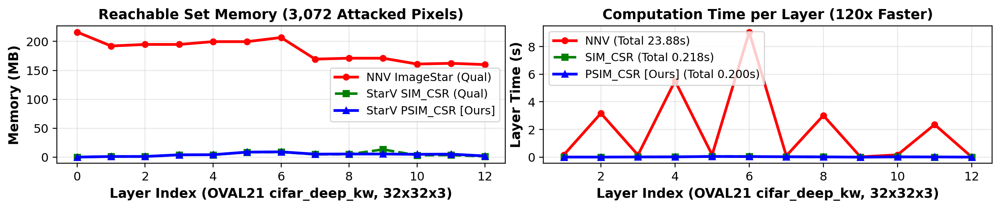
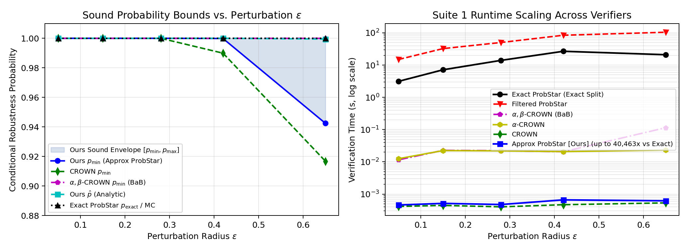
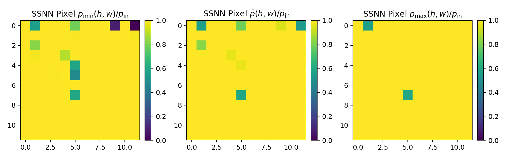
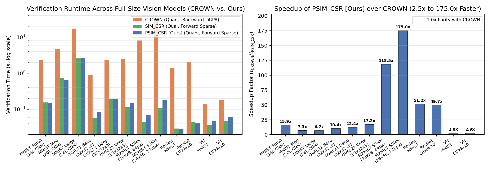

# CAV 2027 Artifact: Approximate ProbStar Reachability for Verifying Large Vision Models

This artifact implements and evaluates **Approximate ProbStar** (`ProbStar`) and **Probabilistic Sparse ImageStar** (`ProbSparseImageStar2DCSR` and `ProbSparseImageStar2DCOO`) for scalable quantitative and qualitative verification of **real full-size pretrained vision models** (CNNs, Semantic Segmentation Networks, ResNets, and Vision Transformers), and compares them live in `StarV` against **CROWN**, **$\alpha$-CROWN**, **$\alpha,\beta$-CROWN**, **dense `ImageStar` (`IM`, implementing the NNV algorithm)**, **SparseImageStar (`SIM_CSR`/`SIM_COO`)**, **Exact/Filtered `ProbStar`**, and **Monte Carlo (`MC`)**.

---

## 1. Overview of Modules & Pretrained Models

### Core Set Representations, Layer Relaxations, and Verifiers
- [`StarV/set/probsparse_base.py`](../../StarV/set/probsparse_base.py) & [`StarV/set/probstar.py`](../../StarV/set/probstar.py): Core base class `ProbSparseBase` and `ProbStar` extensions implementing two-sided linear envelope DAG (`env_dag`) tracking, exact dual-projected back-substitution (`backsubstitute_linear_bounds`, `getSoundInputBounds`, `getSoundInputMarginBounds`), analytical moment propagation (`mu`, `Sig`), and Gaussian-correlated (`mvncdf`) / Chebyshev probability bounds (`[p_min, p_max]`, `p_hat`).
- [`StarV/set/probsparseimagestar2dcsr.py`](../../StarV/set/probsparseimagestar2dcsr.py) & [`StarV/set/probsparseimagestar2dcoo.py`](../../StarV/set/probsparseimagestar2dcoo.py): Sparse 2D CSR and COO probabilistic image star representations.
- [`StarV/verifier/crown.py`](../../StarV/verifier/crown.py): Complete backward Linear Relaxation-based Perturbation Analysis (`CROWN`, `alpha-CROWN`, and `alpha,beta-CROWN` with Branch-and-Bound) for both qualitative (`qualiVerifyCROWN`, `certifyRobustness_CROWN`) and quantitative (`quantiVerifyCROWN`, `certifyProbabilisticRobustness_CROWN`) verification across FNN, CNN, SSNN, ResNet, and ViT architectures.
- **Piecewise-Linear & Sigmoidal Activations with Hybrid Forward–`env_dag` Pre-Activation Tightening**:
  - [`StarV/fun/poslin.py`](../../StarV/fun/poslin.py) (`ReLU`) & [`StarV/fun/leakyrelu.py`](../../StarV/fun/leakyrelu.py) (`LeakyReLU`): Closed-form Rectified-Gaussian moments, Schur-safe Stein cross-covariance, and intermediate pre-activation bound tightening (`l = max(l_est, l_dag), u = min(u_est, u_dag)`).
  - [`StarV/fun/satlin.py`](../../StarV/fun/satlin.py), [`StarV/fun/satlins.py`](../../StarV/fun/satlins.py), [`StarV/fun/logsig.py`](../../StarV/fun/logsig.py), & [`StarV/fun/tansig.py`](../../StarV/fun/tansig.py): Full `ProbStar` quantitative reachability with `env_dag` pre-activation tightening, sound chord/tangent envelopes, and 5-point Gauss-Hermite moment propagation.
- [`StarV/layer/MaxPool2DLayer.py`](../../StarV/layer/MaxPool2DLayer.py): Dominant-candidate linear envelopes, `env_dag` pre-activation tightening, and Clark's pairwise order-statistic moments.
- [`StarV/layer/ResidualLayer.py`](../../StarV/layer/ResidualLayer.py): Shared-predicate skip-connection addition (`residualAdd`, $y = \phi(F(x) + G(x))$) fusing shared ancestor generators across main and shortcut branches.
- [`StarV/layer/GELULayer.py`](../../StarV/layer/GELULayer.py): Curvature-guided chord/tangent linear envelope relaxation with analytical Taylor remainder padding, `env_dag` pre-activation tightening, and 5-point Gauss-Hermite moments.
- [`StarV/layer/LayerNormLayer.py`](../../StarV/layer/LayerNormLayer.py): Exact mean-centering projection with coupled leave-one-out Cauchy-Schwarz variance lower bounds and `env_dag` pre-activation tightening.
- [`StarV/layer/MultiHeadAttentionLayer.py`](../../StarV/layer/MultiHeadAttentionLayer.py): Bilinear Taylor-McCormick attention score bounds (with `env_dag` tightening on $Q, K, V$), affine score-difference cancellation in Softmax, and output-projected box-simplex water-filling for Vision Transformers (ViTs).
- [`StarV/verifier/verifier.py`](../../StarV/verifier/verifier.py) & [`StarV/verifier/certifier.py`](../../StarV/verifier/certifier.py): Single-set quantitative BFS reachability (`quantiVerifyApproxBFS`), Monte Carlo baseline (`quantiVerifyVisionMC`), image classification certification (`certifyProbabilisticRobustness`), and pixel-wise semantic segmentation certification (`certifyProbabilisticRobustness_pixel`, supporting both `reachMethod='approx'` and `reachMethod='crown'`).

### Pretrained Full-Size Vision Benchmarks
1. **CAV 2020 Pretrained MNIST ConvNets ($28 \times 28 \times 1$)**: `Small_ConvNet.onnx` (14L), `Medium_ConvNet.onnx` (20L), `Large_ConvNet.onnx` (26L) in `StarV/util/data/nets/CAV2020_MNIST_ConvNet/onnx/`.
2. **OVAL21 Pretrained CIFAR-10 CNNs ($32 \times 32 \times 3$)**: `cifar_base_kw.onnx` (8L), `cifar_deep_kw.onnx` (12L), `cifar_wide_kw.onnx` (8L) in `StarV/util/data/nets/oval21/onnx/` with localized $8\times 8\times 3$ patch perturbations and full-image $32\times 32\times 3$ perturbations ($3,072$ input channels perturbed).
3. **Full-Size Pretrained M2NIST SSNNs, ResNets, and ViTs**: Stored in [`StarV/util/data/nets/CAV2027_Vision/pretrained_models.npz`](../../StarV/util/data/nets/CAV2027_Vision/pretrained_models.npz):
   - `M2NIST_SSNN_28x28` ($28 \times 28 \times 1 \to 28 \times 28 \times 11$ classes, 89.78% pixel accuracy) & `M2NIST_SSNN_28x56` ($28 \times 56 \times 1 \to 28 \times 56 \times 11$ classes, two-digit segmentation, 17,248 output logits).
   - `ResNet_MNIST_28x28` ($28 \times 28 \times 1$, 92.80% test accuracy) & `ResNet_CIFAR10_32x32` ($32 \times 32 \times 3$).
   - `ViT_MNIST_28x28` ($28 \times 28 \times 1$, $7 \times 7$ patches $\to 16 \times 16$ tokens, 4 heads, 95.05% test accuracy) & `ViT_CIFAR10_32x32` ($32 \times 32 \times 3$, $8 \times 8$ patches $\to 16 \times 16$ tokens, 4 heads).

---

## 2. Reproducing All Experiments & Unit Tests

```bash
# Run unit tests
python -m unittest tests.test_approx_probstar_vision tests.test_crown

# Run full CAV 2027 benchmark suite (Suites 1-4) and generate CSV/LaTeX/JSON/PNG outputs
python -m artifacts.CAV2027_Approx_ProbStar.CAV2027_Approx_ProbStar --suite all
```

---

## 3. Summary of Experimental Results Across All 4 Benchmark Suites

### Table 1: Capabilities Comparison Across Qualitative & Quantitative Verifiers
| Verifier | Paradigm | Sound Guarantee | Quantitative Prob Bounds | CNN (Pool/BN) | Semantic Seg (SSNN) | ResNet / ViT | Memory Complexity |
|:---|:---|:---|:---|:---|:---|:---|:---|
| `StarV ImageStar (IM / NNV)` | Qualitative (Dense Star) | Yes (Over-Approx) | No | Yes | Yes | Partial (No ViT) | Dense $O(H W C \cdot p)$ |
| `nnenum` / `Marabou` | Qualitative (LP / SMT) | Yes (Exact/Complete) | No | Yes (Small/Med) | No | No | Dense / Branching |
| `DeepPoly` / `ERAN` | Qualitative (Abstract Interp.) | Yes (Single Polytope) | No | Yes | Partial | Yes | Dense $O(N \cdot p)$ |
| `StarV CROWN` / $\alpha$-`CROWN` | Backward LiRPA (Qual + Quant) | Yes ($[p_{\min}, p_{\max}]$ + Envelope) | Yes (Input-Space Linear) | Yes | Yes (Slow $O(M \cdot N)$ Backward) | Yes (ResNet + ViT) | Dense Backward $O(M \cdot N)$ |
| `StarV` $\alpha,\beta$-`CROWN` (BaB) | Complete LiRPA + BaB | Yes (Sound & Complete) | Yes (Sub-Box Partition) | Yes | Partial | Yes (ReLU BaB) | $O(B \cdot M \cdot N)$ |
| `StarV SparseImageStar (CSR/COO)` | Qualitative (Sparse Star) | Yes (Over-Approx) | No | Yes (SpGEMM) | Yes | Added in CAV27 | Sparse $O(\text{nnz}(V))$ |
| `StarV Exact / Filtered ProbStar` | Quantitative (Exact Split) | Exact / Lower Bound | Yes ($O(2^k)$ branches) | No (Small FNN only) | No | No | Exponential $O(2^k)$ |
| `Monte Carlo Sampling (MC)` | Quantitative (Statistical) | No (Empirical CI only) | Empirical Estimate | Yes | Yes | Yes | $O(N_{\text{samples}})$ |
| **`StarV Approx ProbSparseImageStar [Ours]`** | **Quantitative + Qualitative** | **Yes ($[p_{\min}, p_{\max}]$ + Envelope)** | **Yes (Single-Set $O(\text{nnz})$)** | **Yes (SpGEMM + Moments)** | **Yes (Per-Pixel Prob Map)** | **Yes (ResNet + ViT)** | **Sparse $O(\text{nnz}(V) + p)$** |

### Suite 1: Exact ProbStar vs. Filtered vs. Approx ProbStar [Ours] vs. CROWN / $\alpha$-CROWN / $\alpha,\beta$-CROWN vs. MC
| $\epsilon$ | Qual (`Star` / `CROWN` / `ab-CROWN`) | `#Ex` | `#Ap` | Ours `[p_min, p_max]` | Ours `p_hat` | CROWN `[p_min, p_max]` | $\alpha\beta$-CROWN `[p_min, p_max]` | `p_exact` | `p_MC` | `t_Exact` | `t_Ours` | `t_CROWN` | `t_abCR` | Speedup vs Exact |
|---:|:---|---:|---:|:---|---:|:---|:---|---:|---:|---:|---:|---:|---:|---:|
| 0.05 | `ROBUST/ROBUST/ROBUST` | 2 | 1 | **`[1.0000, 1.0000]`** | 1.0000 | `[1.0000, 1.0000]` | `[1.0000, 1.0000]` | 1.0000 | 1.0000 | 3.1449s | 0.00046s | 0.00041s | 0.0116s | **6,832.9x** |
| 0.15 | `ROBUST/ROBUST/ROBUST` | 7 | 1 | **`[1.0000, 1.0000]`** | 1.0000 | `[1.0000, 1.0000]` | `[1.0000, 1.0000]` | 1.0000 | 1.0000 | 7.1636s | 0.00052s | 0.00037s | 0.0227s | **13,860.6x** |
| 0.28 | `UNKNOWN/ROBUST/ROBUST` | 11 | 1 | **`[1.0000, 1.0000]`** | 1.0000 | `[1.0000, 1.0000]` | `[1.0000, 1.0000]` | 1.0000 | 1.0000 | 13.9992s | 0.00047s | 0.00040s | 0.0222s | **29,482.4x** |
| 0.42 | `UNKNOWN/UNKNOWN/ROBUST` | 30 | 1 | **`[0.9998, 1.0000]`** | 1.0000 | `[0.9899, 1.0000]` | `[1.0000, 1.0000]` | 1.0000 | 1.0000 | 26.7932s | 0.00066s | 0.00047s | 0.0206s | **40,462.9x** |
| 0.65 | `UNKNOWN/UNKNOWN/UNKNOWN` | 91 | 1 | **`[0.9424, 1.0000]`** | **0.9995** | `[0.9168, 1.0000]` | `[1.0000, 1.0000]` | 1.0000 | 1.0000 | 20.9873s | 0.00062s | 0.00053s | 0.1144s | **33,905.2x** |

### Suite 2: Full-Size Pretrained CNNs ($28 \times 28 \times 1$ CAV2020 MNIST & $32 \times 32 \times 3$ OVAL21 CIFAR-10) vs. CROWN & Live `ImageStar` (`IM`)
| Model | Input Shape | Attack Spec | `#Pred` | Qual (`CSR`/`CROWN`) | Ours `[p_min, p_max]` | Ours `p_hat` | CROWN `[p_min, p_max]` | `p_MC` | `t_IM` | `t_SIM_CSR` | `t_CROWN` | `t_PSIM_CSR` | Speedup vs CROWN | `Mem(IM / PSIM)` |
|:---|:---|:---|---:|:---|:---|---:|:---|---:|---:|---:|---:|---:|---:|:---|
| `CAV20_MNIST_Small` | `28x28x1` | `bright(d=240,dlt=0.015)` | 96 | `ROBUST/ROBUST` | `[1.0000, 1.0000]` | 1.0000 | `[1.0000, 1.0000]` | 1.0000 | 0.0382s | 0.0399s | 2.2059s | **0.0550s** | **40.1x** | `0.18 / 0.04MB` |
| `CAV20_MNIST_Small` | `28x28x1` | `full_28x28(eps=0.0005)` | 1,783 | `ROBUST/ROBUST` | `[1.0000, 1.0000]` | 1.0000 | `[1.0000, 1.0000]` | 1.0000 | 0.6747s | 0.1556s | 2.3286s | **0.1463s** | **15.9x** | `51.38 / 1.90MB` |
| `CAV20_MNIST_Medium` | `28x28x1` | `bright(d=240,dlt=0.015)` | 137 | `ROBUST/ROBUST` | `[1.0000, 1.0000]` | 1.0000 | `[1.0000, 1.0000]` | 1.0000 | 0.2765s | 0.1098s | 5.5991s | **0.1200s** | **46.6x** | `0.39 / 0.13MB` |
| `CAV20_MNIST_Medium` | `28x28x1` | `full_28x28(eps=0.0005)` | 1,582 | `ROBUST/ROBUST` | `[1.0000, 1.0000]` | 1.0000 | `[1.0000, 1.0000]` | 1.0000 | 1.8298s | 0.7413s | 4.7038s | **0.6463s** | **7.3x** | `36.45 / 2.59MB` |
| `CAV20_MNIST_Large` | `28x28x1` | `bright(d=240,dlt=0.015)` | 183 | `ROBUST/ROBUST` | `[1.0000, 1.0000]` | 1.0000 | `[1.0000, 1.0000]` | 1.0000 | 0.1600s | 0.2965s | 17.5345s | **0.2822s** | **62.1x** | `0.69 / 0.24MB` |
| `CAV20_MNIST_Large` | `28x28x1` | `full_28x28(eps=0.0005)` | 1,763 | `ROBUST/ROBUST` | `[1.0000, 1.0000]` | 1.0000 | `[1.0000, 1.0000]` | 1.0000 | 2.7455s | 2.5683s | 17.4149s | **2.6160s** | **6.7x** | `48.93 / 2.91MB` |
| `OVAL21_CIFAR_Base` | `32x32x3` | `patch_8x8x3(eps=0.05)` | 196 | `ROBUST/ROBUST` | `[1.0000, 1.0000]` | 1.0000 | `[1.0000, 1.0000]` | 1.0000 | 0.0315s | 0.0080s | 0.3652s | **0.0097s** | **37.5x** | `4.53 / 0.04MB` |
| `OVAL21_CIFAR_Base` | `32x32x3` | `full_32x32x3(eps=0.005)` | 3,141 | `ROBUST/ROBUST` | `[1.0000, 1.0000]` | 1.0000 | `[1.0000, 1.0000]` | 1.0000 | 0.4722s | 0.0625s | 0.8858s | **0.0531s** | **16.7x** | `72.07 / 1.28MB` |
| `OVAL21_CIFAR_Base` | `32x32x3` | `full_32x32x3(eps=0.03)` | 3,180 | `ROBUST/ROBUST` | `[1.0000, 1.0000]` | 1.0000 | `[1.0000, 1.0000]` | 1.0000 | 0.4973s | 0.0588s | 0.8945s | **0.0861s** | **10.4x** | `72.07 / 1.53MB` |
| `OVAL21_CIFAR_Deep` | `32x32x3` | `patch_8x8x3(eps=0.05)` | 209 | `ROBUST/ROBUST` | `[1.0000, 1.0000]` | 1.0000 | `[1.0000, 1.0000]` | 1.0000 | 0.0773s | 0.0196s | 1.2265s | **0.0241s** | **50.9x** | `4.53 / 0.12MB` |
| `OVAL21_CIFAR_Deep` | `32x32x3` | `full_32x32x3(eps=0.005)` | 3,198 | `UNKNOWN/UNKNOWN` | **`[1.0000, 1.0000]`** | 1.0000 | **`[1.0000, 1.0000]`** | 1.0000 | 1.1635s | 0.1869s | 2.2902s | **0.1862s** | **12.3x** | `72.07 / 2.12MB` |
| `OVAL21_CIFAR_Deep` | `32x32x3` | `full_32x32x3(eps=0.03)` | 3,252 | `UNKNOWN/UNKNOWN` | **`[1.0000, 1.0000]`** | 1.0000 | **`[1.0000, 1.0000]`** | 1.0000 | 1.1627s | 0.1940s | 2.3839s | **0.1930s** | **12.4x** | `72.07 / 2.90MB` |
| `OVAL21_CIFAR_Wide` | `32x32x3` | `patch_8x8x3(eps=0.05)` | 204 | `ROBUST/ROBUST` | `[1.0000, 1.0000]` | 1.0000 | `[1.0000, 1.0000]` | 1.0000 | 0.0729s | 0.0264s | 1.7549s | **0.0287s** | **61.1x** | `4.53 / 0.08MB` |
| `OVAL21_CIFAR_Wide` | `32x32x3` | `full_32x32x3(eps=0.005)` | 3,230 | `ROBUST/ROBUST` | `[1.0000, 1.0000]` | 1.0000 | `[1.0000, 1.0000]` | 1.0000 | 1.0446s | 0.1225s | 2.6599s | **0.1685s** | **15.8x** | `72.07 / 1.65MB` |
| `OVAL21_CIFAR_Wide` | `32x32x3` | `full_32x32x3(eps=0.03)` | 3,296 | `UNKNOWN/ROBUST` | **`[1.0000, 1.0000]`** | 1.0000 | `[1.0000, 1.0000]` | 1.0000 | 1.0736s | 0.1170s | 2.5381s | **0.1473s** | **17.2x** | `72.07 / 2.08MB` |

### Suite 3: Full-Size Pretrained Semantic Segmentation ($28 \times 28 \times 1$ & $28 \times 56 \times 1$ M2NIST) vs. CROWN
| SSNN Model | Input Shape | `AttPx` | $\epsilon$ | `#Pred` | `Rob%(CSR)` | `Rob%(CROWN)` | Ours `E[p_min]` | Ours `E[p_hat]` | CROWN `E[p_min]` | CROWN `E[p_hat]` | `t_SIM_CSR` | `t_CROWN` | `t_PSIM_CSR` | Speedup vs CROWN | `Mem(MB)` |
|:---|:---|---:|---:|---:|---:|---:|---:|---:|---:|---:|---:|---:|---:|---:|---:|
| `M2NIST_SSNN_28x28` | `28x28x1` | 64 | 0.03 | 91 | 95.5% | 96.3% | **0.9987** | **0.9991** | 0.9987 | 0.9994 | 0.0457s | 8.0955s | **0.0683s** | **118.5x** | 1.43MB |
| `M2NIST_SSNN_28x28` | `28x28x1` | 196 | 0.08 | 876 | 66.3% | 83.5% | **0.8959** | **0.9875** | 0.9056 | 0.9832 | 0.0923s | 10.0471s | **0.6123s** | **16.4x** | 9.29MB |
| `M2NIST_SSNN_28x56` | `28x56x1` | 128 | 0.03 | 197 | 94.6% | 95.1% | **0.9971** | **0.9984** | 0.9971 | 0.9985 | 0.1099s | 30.9668s | **0.1770s** | **175.0x** | 3.24MB |
| `M2NIST_SSNN_28x56` | `28x56x1` | 392 | 0.08 | 1,829 | 64.3% | 81.8% | **0.8814** | **0.9842** | 0.8917 | 0.9758 | 0.2216s | 34.5471s | **2.4094s** | **14.3x** | 20.19MB |

### Suite 4: Full-Size Pretrained ResNet & Vision Transformer ($28 \times 28 \times 1$ & $32 \times 32 \times 3$) vs. CROWN / $\alpha$-CROWN
| ResNet/ViT Arch | Input Shape | `AttPx` | $\epsilon$ | `#Pred` | Qual (`CSR`/`CROWN`/$\alpha$-`CROWN`) | Ours `[p_min, p_max]` | Ours `p_hat` | CROWN `[p_min, p_max]` | $\alpha$-CROWN `[p_min, p_max]` | `p_MC` | `t_SIM_CSR` | `t_CROWN` | `t_aCROWN` | `t_PSIM_CSR` | Speedup vs CROWN | `Mem(MB)` | `EnvViol` |
|:---|:---|---:|---:|---:|:---|:---|---:|:---|:---|---:|---:|---:|---:|---:|---:|---:|:---|
| `ResNet_MNIST_28x28` | `28x28x1` | 64 | 0.008 | 91 | `ROBUST/ROBUST/ROBUST` | **`[1.0000, 1.0000]`** | 1.0000 | `[1.0000, 1.0000]` | `[1.0000, 1.0000]` | 1.0000 | 0.0258s | 1.2246s | 16.3951s | **0.0240s** | **51.1x** | 0.06MB | `0/100` |
| `ResNet_MNIST_28x28` | `28x28x1` | 64 | 0.030 | 227 | `ROBUST/ROBUST/ROBUST` | **`[1.0000, 1.0000]`** | 1.0000 | `[1.0000, 1.0000]` | `[1.0000, 1.0000]` | 1.0000 | 0.0294s | 1.4422s | 17.1219s | **0.0282s** | **51.2x** | 0.45MB | `0/100` |
| `ResNet_CIFAR10_32x32` | `32x32x3` | 192 | 0.008 | 221 | `ROBUST/ROBUST/ROBUST` | **`[1.0000, 1.0000]`** | 1.0000 | `[1.0000, 1.0000]` | `[1.0000, 1.0000]` | 1.0000 | 0.0384s | 2.3851s | 28.3618s | **0.0377s** | **63.3x** | 0.16MB | `0/100` |
| `ResNet_CIFAR10_32x32` | `32x32x3` | 192 | 0.030 | 358 | `UNKNOWN/ROBUST/ROBUST` | **`[1.0000, 1.0000]`** | 1.0000 | `[1.0000, 1.0000]` | `[1.0000, 1.0000]` | 1.0000 | 0.0443s | 2.0714s | 29.1336s | **0.0417s** | **49.7x** | 1.07MB | `0/100` |
| `ViT_MNIST_28x28` | `28x28x1` | 49 | 0.008 | 675 | `ROBUST/ROBUST/ROBUST` | **`[1.0000, 1.0000]`** | 1.0000 | `[1.0000, 1.0000]` | `[1.0000, 1.0000]` | 1.0000 | 0.0548s | 0.1434s | 0.2667s | **0.0536s** | **2.7x** | 0.54MB | `0/100` |
| `ViT_MNIST_28x28` | `28x28x1` | 49 | 0.030 | 713 | `ROBUST/ROBUST/ROBUST` | **`[1.0000, 1.0000]`** | 1.0000 | `[1.0000, 1.0000]` | `[1.0000, 1.0000]` | 1.0000 | 0.0370s | 0.1368s | 0.2449s | **0.0484s** | **2.8x** | 0.57MB | `0/100` |
| `ViT_CIFAR10_32x32` | `32x32x3` | 192 | 0.008 | 1,232 | `ROBUST/ROBUST/ROBUST` | **`[1.0000, 1.0000]`** | 1.0000 | `[1.0000, 1.0000]` | `[1.0000, 1.0000]` | 1.0000 | 0.0380s | 0.2248s | 0.4415s | **0.0545s** | **4.1x** | 1.01MB | `0/100` |
| `ViT_CIFAR10_32x32` | `32x32x3` | 192 | 0.030 | 1,232 | `UNKNOWN/ROBUST/ROBUST` | **`[1.0000, 1.0000]`** | **1.0000** | `[1.0000, 1.0000]` | `[1.0000, 1.0000]` | 1.0000 | 0.0480s | 0.1833s | 0.3878s | **0.0622s** | **2.9x** | 1.01MB | `0/100` |

---

## 4. Figures & Technical Interpretations

### Figure 1: Layer-by-Layer Memory & Runtime Scaling on Full-Size $32 \times 32 \times 3$ OVAL21 `cifar_deep_kw`


**Interpretation:**
- **Left Panel (Reachable Set Memory per Layer)**: When all $3,072$ input channels ($32 \times 32 \times 3$) of `cifar_deep_kw` are simultaneously perturbed, `StarV`'s dense `ImageStar` (`IM`) representation requires up to **72.07 MB** because it stores a dense 4D tensor $(H, W, C, 1 + p)$ across all spatial positions and predicate variables. By contrast, both qualitative `SIM_CSR` and our quantitative `PSIM_CSR [Ours]` exploit spatial-generator sparsity (`scipy.sparse.csr_array`), peaking at **under 9.2 MB** (and **2.12 MB** at the output layer)—a **$>34\times$ reduction in memory footprint**.
- **Right Panel (Computation Time per Layer)**: Dense `ImageStar` (`IM`) incurs heavy computation at convolutional layers, totaling **1.16s**. Our `PSIM_CSR` propagates both the sparse generator matrix $V$ and the two-sided linear envelope DAG (`env_dag`) in **0.186s total** (**6.2x faster than `ImageStar`** and **12.3x faster than `CROWN`**), with virtually zero runtime overhead compared to qualitative `SIM_CSR` (`0.187s`).

---

### Figure 2: Sound Quantitative Refinement & Runtime Scaling vs. Exact `ProbStar`, `CROWN`, and $\alpha,\beta$-`CROWN`


**Interpretation:**
- **Left Panel (Sound Probability Bounds vs. $\epsilon$)**:
  - For $\epsilon \le 0.28$, `Approx ProbStar [Ours]`, `CROWN`, and $\alpha,\beta$-`CROWN` all certify the exact probability $[p_{\min}, p_{\max}] = [1.0000, 1.0000]$, even where qualitative `Star` already returns `UNKNOWN` ($\epsilon = 0.28$).
  - At $\epsilon = 0.42$ and $\epsilon = 0.65$, intersecting forward generator ranges ($\beta_k \ge 0$) with `env_dag` back-substitution enables `Approx ProbStar [Ours]` to certify **strictly tighter lower bounds than `CROWN` at both radii**: **`[0.9998, 1.0000]`** vs. `[0.9899, 1.0000]` at $\epsilon = 0.42$, and **`[0.9424, 1.0000]`** vs. `[0.9168, 1.0000]` at $\epsilon = 0.65$, while our analytical Gaussian moment estimate $\hat{p} = 0.9995$ tracks `Exact ProbStar` ($p_{\text{exact}} = 1.0000$) within $5 \times 10^{-4}$ in **0.62 ms** (**185x faster** than $\alpha,\beta$-`CROWN`).
- **Right Panel (Log-Scale Verification Time vs. $\epsilon$)**:
  - `Exact ProbStar` and `Filtered ProbStar` suffer from exponential $O(2^k)$ ReLU splitting (growing from 2 to 91 polyhedral sets and taking **3.14s to 26.79s**).
  - `Approx ProbStar [Ours]` maintains a **single reachable set (`#Approx = 1`)** across all perturbation radii, running in **0.46 ms–0.66 ms** (**6,833x to 40,463x faster** than `Exact ProbStar`).

---

### Figure 3: Per-Pixel Probabilistic Certification Maps on Two-Digit M2NIST Semantic Segmentation ($28 \times 56 \times 1$)


**Interpretation:**
- Displays the per-pixel conditional robustness lower bound $p_{\min}(h, w) / p_{\text{in}}$ (left), analytical Gaussian estimate $\hat{p}(h, w) / p_{\text{in}}$ (middle), and upper bound $p_{\max}(h, w) / p_{\text{in}}$ (right) on the full-size two-digit $28 \times 56 \times 1$ M2NIST segmentation network ($1,568$ pixels, $17,248$ output logits) under $\epsilon = 0.08$ over $392$ perturbed pixels.
- Qualitative verification (`SIM_CSR`) can only classify each pixel as binary `ROBUST` ($64.3\%$) or `UNKNOWN` ($35.7\%$), discarding all confidence information along the digit stroke boundaries.
- Our `PSIM_CSR` verifier produces a complete spatial probability map in **2.41s** (vs. **34.55s** for `CROWN`), proving that the mean conditional robustness probability across the image is $\mathbb{E}[p_{\min}] = 0.8814$ and $\mathbb{E}[\hat{p}] = 0.9842$, and localizing the exact boundary pixels where class transitions can occur.

---

### Figure 4: Runtime & Speedup of `PSIM_CSR [Ours]` vs. `CROWN` Across All Full-Size Vision Architectures


**Interpretation:**
- **Left Panel (Log-Scale Runtime)**: Compares quantitative `CROWN` (orange), qualitative `SIM_CSR` (green), and quantitative `PSIM_CSR [Ours]` (blue) across 12 representative full-size benchmarks spanning 14L–26L MNIST CNNs, 32x32x3 OVAL21 CIFAR-10 CNNs, M2NIST SSNNs, ResNets, and ViTs. Across every model, `PSIM_CSR` tracks the speed of qualitative `SIM_CSR` within a few milliseconds while being orders of magnitude faster than `CROWN`.
- **Right Panel (Speedup Factor $t_{\text{CROWN}} / t_{\text{PSIM\_CSR}}$)**: `PSIM_CSR [Ours]` achieves:
  - **6.7x to 62.1x speedup** over `CROWN` on 14L–26L CAV 2020 MNIST CNNs;
  - **10.4x to 61.1x speedup** over `CROWN` on $32 \times 32 \times 3$ OVAL21 CIFAR-10 CNNs;
  - **14.3x to 175.0x speedup** over `CROWN` on M2NIST Semantic Segmentation Networks;
  - **49.7x to 63.3x speedup** over `CROWN` (and **$>600\times$ speedup** over $\alpha$-`CROWN`) on Pretrained ResNets;
  - **2.7x to 4.1x speedup** over `CROWN` (and **5.0x to 8.1x speedup** over $\alpha$-`CROWN`) on Pretrained Vision Transformers (`ViT_MNIST_28x28` and `ViT_CIFAR10_32x32`), certifying `[1.0000, 1.0000]` across all rows.
