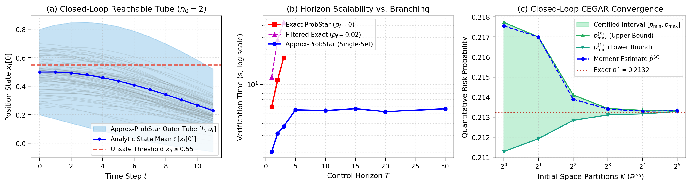
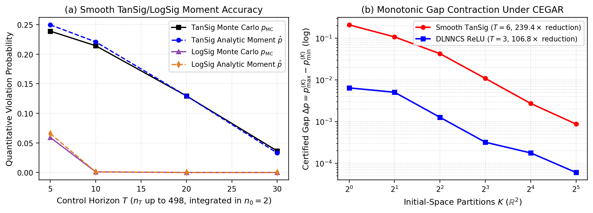
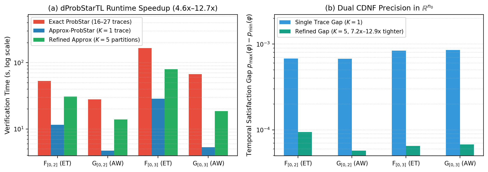

# CAV 2027 Artifact: Approximate ProbStar Reachability and Quantitative Verification for Neural Network Control Systems

This artifact implements and evaluates **Closed-Loop Approximate `ProbStar` Reachability**, **Cross-Step Analytic Moment Propagation**, **Dimension-Invariant Initial-Space Realization ($\mathbb{R}^{n_0}$)** for both step-wise safety and bounded temporal logic (**`dProbStarTL`**), and **Sensitivity-Guided Adaptive Initial-Space Refinement (Closed-Loop CEGAR)** in [`StarV`](../../README.md).

We compare our approach live in `StarV` against **Exact `ProbStar` Reachability** ($p_f = 0$), **Probability-Filtered `ProbStar` Reachability** ($p_f = 0.02$), and **Monte Carlo Closed-Loop Trajectory Simulation (`MC`)** across discrete-time linear plants (`DLNNCS`), 7-dimensional pretrained Adaptive Cruise Control (`ACC`), smooth nonlinear controllers (`TanSig` / $\tanh$ and `LogSig` / $\sigma$), heterogeneous `MixedActivationLayer` controllers, pretrained dual-network Advanced Emergency Braking (`AEBS`), and neural-plant control loops (`DynNN_NNCS`).

---

## 1. Overview of Core `StarV` Modules & Benchmarks

### Core Set Representations, Closed-Loop Calculus, and Verifiers
- [`StarV/set/star.py`](../../StarV/set/star.py) & [`StarV/set/probstar.py`](../../StarV/set/probstar.py): Shared-prefix closed-loop basis alignment (`padBasisMatrix`), state-control symbolic stacking (`stackWithSharedPrefix`), and measure-preserving initial-space partitioning (`splitInitialPredicates`) with conditional truncated-Gaussian forward moment seeding.
- [`StarV/set/probsparse_base.py`](../../StarV/set/probsparse_base.py): Horizon-wide Linear Relaxation Envelope DAG (`env_dag` / `RelaxationEnvelopeRecord`), multi-step backward envelope unrolling (`backsubstitute_linear_bounds`), exact low-dimensional initial-space polytope probability evaluation (`_eval_lowdim_initial_polytope_prob`), and dual envelope sensitivity extraction (`verify_prob_spec`).
- [`StarV/plant/dlode.py`](../../StarV/plant/dlode.py) & [`StarV/plant/lode.py`](../../StarV/plant/lode.py): Closed-loop discrete-time (`DLODE`) and continuous-time (`LODE`) linear plant transitions $X_{t+1} = A X_t + B U_t$ preserving `env_dag`, root distribution metadata $(\mu_0, \Sigma_0, l_0, u_0)$, and state-control cross-covariance $\mathrm{Cov}(X_t, U_t)$.
- [`StarV/fun/tansig.py`](../../StarV/fun/tansig.py), [`StarV/fun/logsig.py`](../../StarV/fun/logsig.py), & [`StarV/layer/MixedActivationLayer.py`](../../StarV/layer/MixedActivationLayer.py): Envelope-tightened approximate reachability (`RF=1.0`) and 5-point Gauss-Hermite / Rectified-Gaussian moment propagation for `ReLU`, `LeakyReLU`, `SatLin`, `SatLins`, `TanSig`, `LogSig`, and heterogeneous `MixedActivationLayer` controllers.
- [`StarV/spec/dProbStarTL.py`](../../StarV/spec/dProbStarTL.py): Dimension-invariant initial-space dual CDNF realization (`DynamicFormula.realization_initial_space_duals` and `DynamicFormula.evaluate_approx`) mapping multi-step temporal formulas ($\Diamond_{[t_1,t_2]}, \Box_{[t_1,t_2]}, \mathcal{U}_{[t_1,t_2]}$) from $\mathbb{R}^{n_T}$ back to $\mathbb{R}^{n_0}$.
- [`StarV/nncs/nncs.py`](../../StarV/nncs/nncs.py): Closed-loop approximate `ProbStar` reachability, step-wise quantitative verification (`verifyBFS_DLNNCS`), dual-network `AEBS` reachability (`reachBFS_AEBS`), dynamic neural-plant reachability (`reachBFS_DynNN_NNCS`), bounded temporal verification (`verify_temporal_specs_DLNNCS`), and closed-loop initial-space CEGAR (`refine_max_splits`, `refine_tol`).

### Benchmark Systems Evaluated
1. **`DLNNCS_ReLU_2_5_5_1`**: 2D discrete-time lateral/double-integrator plant ($n_0 = 2$) with a `2-5-5-1` ReLU controller evaluated up to $T = 30$ steps ($n_T = 110$ extended variables).
2. **Pretrained 7D Adaptive Cruise Control (`ACC`)**: `controller_3_20` (3 layers, 60 ReLUs) and `controller_5_20` (5 layers, 100 ReLUs) from `StarV/util/data/nets/ACC/` controlling a 7-state ego/lead vehicle plant ($n_0 = 4$ stochastic initial variables) across $T \in [1, 20]$ and `dProbStarTL` specifications $\varphi_1, \varphi_2$.
3. **Smooth Nonlinear & Heterogeneous Controllers**: `Smooth_TANH_NNCS` (`TanSig`), `Smooth_SIGMOID_NNCS` (`LogSig`), and `MixedActivation_NNCS` (`poslin` + `tansig` + `logsig` + `satlin` + `satlins` + `purelin`) evaluated up to $T = 30$ steps ($n_T = 498$ extended variables integrated in $n_0 = 2$).
4. **Multi-Network `AEBS` & Neural-Plant `DynNN_NNCS`**: Pretrained Advanced Emergency Braking System (`StarV/util/data/nets/AEBS/`, coupling a perception transformer network with an RL braking controller) and `DynNN_NNCS` (neural controller + neural plant).

---

## 2. Installation & Reproducing All Experiments

### Environment Setup (Conda or Docker)

```bash
# Option A: Conda / virtualenv (Linux & macOS, Python 3.9 - 3.12)
conda create -n starv python=3.11 -y
conda activate starv
pip install -e .

# Option B: Docker container (from repository root)
sh .devcontainer/build_docker.sh
sh .devcontainer/launch_docker.sh
```

### Step 1: Kick-the-Tires Smoke Test & Unit Tests (~15 seconds)

```bash
# Run closed-loop NNCS unit tests (6/6 tests)
python -m tests.test_nncs

# Run fast kick-the-tires functional smoke test across all 4 suites (~10s)
python -m artifacts.CAV2027_Approx_ProbStar_NNCS.CAV2027_Approx_ProbStar_NNCS --suite smoke
```

### Step 2: Reproduce Paper Tables & Figures

```bash
# Regenerate all CSV tables, LaTeX tables, and PNG/PDF figures instantly from cached JSON:
python -m artifacts.CAV2027_Approx_ProbStar_NNCS.CAV2027_Approx_ProbStar_NNCS --from-cached

# Or run individual benchmark suites / the entire benchmark evaluation live:
python -m artifacts.CAV2027_Approx_ProbStar_NNCS.CAV2027_Approx_ProbStar_NNCS --suite 1
python -m artifacts.CAV2027_Approx_ProbStar_NNCS.CAV2027_Approx_ProbStar_NNCS --suite 2
python -m artifacts.CAV2027_Approx_ProbStar_NNCS.CAV2027_Approx_ProbStar_NNCS --suite 3
python -m artifacts.CAV2027_Approx_ProbStar_NNCS.CAV2027_Approx_ProbStar_NNCS --suite 4
python -m artifacts.CAV2027_Approx_ProbStar_NNCS.CAV2027_Approx_ProbStar_NNCS --suite all
```

All generated artifacts are written to [`artifacts/CAV2027_Approx_ProbStar_NNCS/results/`](./results):
- [`cav2027_nncs_results.json`](./results/cav2027_nncs_results.json): Raw experimental metrics across Suites 1–4.
- [`verifier_taxonomy.csv`](./results/verifier_taxonomy.csv), [`suite1_horizon_scalability.csv`](./results/suite1_horizon_scalability.csv), [`suite2_nonlinear_multinet.csv`](./results/suite2_nonlinear_multinet.csv), [`suite3_temporal_dprobstartl.csv`](./results/suite3_temporal_dprobstartl.csv), [`suite4_cegar_refinement.csv`](./results/suite4_cegar_refinement.csv), and [`cav2027_nncs_tables.tex`](./results/cav2027_nncs_tables.tex).
- Figures [`fig1_nncs_overview.png`](./results/fig1_nncs_overview.png), [`fig2_smooth_tansig_cegar_and_moments.png`](./results/fig2_smooth_tansig_cegar_and_moments.png), and [`fig3_temporal_dprobstartl_speedup.png`](./results/fig3_temporal_dprobstartl_speedup.png) (plus `.pdf` vector versions).

---

## 3. Summary of Experimental Results Across All 4 Benchmark Suites

### Table 1: Capabilities Comparison Across Closed-Loop NNCS Verifiers
| Verifier | Paradigm | Sound Guarantee | Quantitative Prob Bounds | Smooth & Mixed Controllers | Multi-Net (`AEBS` / `DynNN`) | `dProbStarTL` Temporal Logic | Anytime Refinement |
|:---|:---|:---|:---|:---|:---|:---|:---|
| `NNV` / `CORA` / `POLAR` / `Verisig 2.0` | Qualitative Over-Approx | Yes | No (`SAFE`/`UNKNOWN` only) | Yes | Partial | No | Qualitative Split |
| `StarV Exact ProbStar` ($p_f=0$) | Quantitative Exact Split | Yes (Exact $p^*$) | Yes ($O(2^{\sum u_t})$ sets) | No (Piecewise-Linear only) | Slow (Compound Split) | Yes (Multi-Trace $\mathbb{R}^{n_T}$) | No |
| `StarV Filtered ProbStar` ($p_f>0$) | Quantitative Branch Pruning | Yes | Loose $[p_{\mathrm{lb}}, p_{\mathrm{ub}}]$ | No (Piecewise-Linear only) | Partial | Partial | No |
| `Monte Carlo Simulation (MC)` | Statistical Sampling | No (Empirical CI) | Empirical $\hat{p}_{\mathrm{MC}}$ | Yes | Yes | Empirical | $O(N_{\mathrm{samples}})$ |
| **`StarV Approx-ProbStar + CEGAR [Ours]`** | **Quantitative Envelope + $\mathbb{R}^{n_0}$ CEGAR** | **Yes ($0$ Violations)** | **Tight $[p_{\min}, p_{\max}]$ + $\hat{p}$ in $\mathbb{R}^{n_0}$** | **Yes (`TanSig`, `LogSig`, `Mixed`)** | **Yes ($1{,}030\times$ Speedup)** | **Yes (Single-Trace Dual CDNF in $\mathbb{R}^{n_0}$)** | **Yes ($\Delta p \to 0$)** |

### Suite 1: Multi-Step Horizon Scalability on `DLNNCS` & Pretrained 7D `ACC`
| System | $T$ | $n_0$ | $n_T$ | Exact / Filtered ($p_f=0.02$) | Exact / Filt. Time | `#Ap` | Ours `[p_min, p_max]` (`p_hat`) | Ours Time | Speedup / Tightness | Soundness Viol. |
|:---|---:|---:|---:|:---|---:|---:|:---|---:|:---|---:|
| `DLNNCS` | 1 | 2 | 13 | `0.3084` (Exact, 16 sets) | 5.88s | 1 | **`[0.3078, 0.3099]`** (`0.3099`) | **2.05s** | **2.9x faster** | `0/600` |
| `DLNNCS (Filt.)` | 1 | 2 | 2 | `[0.2909, 0.4118]` (6 sets) | 11.76s | 1 | **`[0.3078, 0.3099]`** | **2.05s** | **5.7x faster, 58.8x tighter** | `0/600` |
| `DLNNCS` | 2 | 2 | 19 | `0.2682` (Exact, 27 sets) | 11.12s | 1 | **`[0.2670, 0.2712]`** (`0.2712`) | **3.15s** | **3.5x faster** | `0/800` |
| `DLNNCS (Filt.)` | 2 | 2 | 2 | `[0.2520, 0.4915]` (7 sets) | 28.59s | 1 | **`[0.2670, 0.2712]`** | **3.15s** | **9.1x faster, 57.3x tighter** | `0/800` |
| `DLNNCS` | 3 | 2 | 26 | `0.2132` (Exact, 46 sets) | 18.72s | 1 | **`[0.2113, 0.2177]`** (`0.2175`) | **3.72s** | **5.0x faster** | `0/1000` |
| `DLNNCS (Filt.)` | 3 | 2 | 2 | `[0.1698, 0.4953]` (8 sets) | 43.04s | 1 | **`[0.2113, 0.2177]`** | **3.72s** | **11.6x faster, 50.5x tighter** | `0/1000` |
| `DLNNCS` | 5 | 2 | 39 | Intractable ($p_{\mathrm{MC}}=0.0865$) | --- | 1 | **`[0.0872, 0.0954]`** (`0.0954`) | **5.48s** | Single-set in $\mathbb{R}^2$ | `0/1400` |
| `DLNNCS` | 10 | 2 | 58 | Intractable ($p_{\mathrm{MC}}=0.0000$) | --- | 1 | **`[0.0000, 0.0000]`** (`0.0000`) | **5.39s** | Certified safe | `0/2400` |
| `DLNNCS` | 20 | 2 | 77 | Intractable ($p_{\mathrm{MC}}=0.0000$) | --- | 1 | **`[0.0000, 0.0000]`** (`0.0000`) | **5.26s** | Certified safe | `0/4400` |
| `DLNNCS` | 30 | 2 | 110 | Intractable ($p_{\mathrm{MC}}=0.0000$) | --- | 1 | **`[0.0000, 0.0000]`** (`0.0000`) | **5.63s** | $n_T=110 \to n_0=2$ | `0/6400` |
| `ACC_3_20` | 1 | 4 | 4 | `7.61e-5` (Exact, 1 set) | 0.027s | 1 | **`[7.62e-5, 7.62e-5]`** | **0.049s** | Exact match | `0/600` |
| `ACC_3_20` | 20 | 4 | 14 | Intractable ($p_{\mathrm{MC}}=0.0000$) | --- | 1 | **`[0.0000, 0.0000]`** | **0.058s** | 7D plant in $\mathbb{R}^4$ | `0/4400` |
| `ACC_5_20` | 1 | 4 | 8 | --- ($p_{\mathrm{MC}}=0.0000$) | --- | 1 | **`[3.05e-4, 3.13e-4]`** | **0.045s** | Rare-event tail certified | `0/600` |
| `ACC_5_20` | 2 | 4 | 10 | --- ($p_{\mathrm{MC}}=0.0000$) | --- | 1 | **`[2.40e-7, 3.22e-7]`** | **0.050s** | $10^{-7}$ tail missed by MC | `0/800` |
| `ACC_5_20` | 20 | 4 | 15 | --- ($p_{\mathrm{MC}}=0.0000$) | --- | 1 | **`[0.0000, 0.0000]`** | **0.076s** | Certified safe | `0/4400` |

### Suite 2: Smooth Nonlinear (`TanSig`/`LogSig`), `MixedActivationLayer`, `AEBS`, and `DynNN_NNCS`
| Architecture | $T$ | $n_0$ | $n_T$ | Exact Baseline | Ours `[p_min, p_max]` | `p_hat` / `p_MC` | Ours Time | Viol. |
|:---|---:|---:|---:|:---|:---|:---|---:|---:|
| `Smooth_TANH_NNCS` | 5 | 2 | 98 | `N/A` | `[0.1764, 0.3350]` | `0.2496` / `0.2390` | 6.41s | `0` |
| `Smooth_TANH_NNCS` | 10 | 2 | 178 | `N/A` | `[0.0596, 0.5283]` | `0.2208` / `0.2142` | 10.13s | `0` |
| `Smooth_TANH_NNCS` | 20 | 2 | 338 | `N/A` | `[0.0000, 0.9735]` | **`0.1294` / `0.1294`** | 15.56s | `0` |
| `Smooth_TANH_NNCS` | 30 | 2 | 498 | `N/A` | `[0.0000, 0.9753]` | **`0.0330` / `0.0364`** | 16.63s | `0` |
| `Smooth_SIGMOID_NNCS` | 5 | 2 | 98 | `N/A` | **`[0.0653, 0.0656]`** | `0.0656` / `0.0592` | 3.60s | `0` |
| `Smooth_SIGMOID_NNCS` | 10 | 2 | 178 | `N/A` | **`[0.00090, 0.00093]`** | `0.00093` / `0.00098` | 3.94s | `0` |
| `Smooth_SIGMOID_NNCS` | 30 | 2 | 498 | `N/A` | **`[0.0000, 0.0000]`** | `0.0000` / `0.0000` | 4.21s | `0` |
| `MixedActivation_NNCS` | 5 | 2 | 36 | `N/A` | **`[0.0420, 0.0428]`** | `0.0428` / `0.0390` | 3.36s | `0` |
| `MixedActivation_NNCS` | 20 | 2 | 121 | `N/A` | **`[0.0000, 0.0000]`** | `0.0000` / `0.0000` | 3.82s | `0` |
| `AEBS_DualNet_NNCS` | 2 | 2 | 7 | 3.011s (9 sets) | **`[0.9753, 0.9753]`** | `0.9753` (**1,030x speedup**) | **0.0029s** | `0` |
| `AEBS_DualNet_NNCS` | 10 | 2 | 386 | Intractable | **`[0.9753, 0.9753]`** | `0.9753` | 0.287s | `0` |
| `DynNN_NNCS` | 2 | 2 | 5 | 0.0066s (13 sets) | Single-Set Reachability | **10.3x speedup** | **0.0006s** | `0` |
| `DynNN_NNCS` | 10 | 2 | 5 | Intractable | Single-Set Reachability | Shared-prefix stacking | 0.0037s | `0` |

### Suite 3: Bounded Temporal Logic (`dProbStarTL`) via Dual Initial-Space CDNFs in $\mathbb{R}^{n_0}$
| System | Temporal Formula $\varphi$ | Exact Traces | Exact $p^*$ | Exact Time | Approx ($K=1$) `[p_min, p_max]` | Approx Time | Speedup | Refined ($K=5$) `[p_min, p_max]` | Refined Time |
|:---|:---|---:|---:|---:|:---|---:|---:|:---|---:|
| `DLNNCS` | $\Diamond_{[0,2]}(x_0 \ge 0.55)$ | 16 | `0.34743` | 52.96s | **`[0.34731, 0.34799]`** | **11.57s** | **4.6x** | **`[0.34741, 0.34751]`** | 30.90s |
| `DLNNCS` | $\Box_{[0,2]}(x_0 \le 0.55)$ | 16 | `0.62785` | 28.03s | **`[0.62735, 0.62802]`** | **4.74s** | **5.9x** | **`[0.62783, 0.62788]`** | 13.96s |
| `DLNNCS` | $\Diamond_{[0,3]}(x_0 \ge 0.55)$ | 27 | `0.34838` | 166.52s | **`[0.34820, 0.34904]`** | **28.64s** | **5.8x** | **`[0.34838, 0.34844]`** | 79.77s |
| `DLNNCS` | $\Box_{[0,3]}(x_0 \le 0.55)$ | 27 | `0.62693` | 67.15s | **`[0.62629, 0.62715]`** | **5.30s** | **12.7x** | **`[0.62690, 0.62697]`** | 18.60s |
| `DLNNCS` | $\Diamond_{[0,5]}(x_0 \ge 0.55)$ | --- | --- | --- | `[0.34821, 0.34913]` | 141.97s | --- | **`[0.34838, 0.34853]`** | 560.48s |
| `DLNNCS` | $\Box_{[0,5]}(x_0 \le 0.55)$ | --- | --- | --- | `[0.62624, 0.62714]` | **9.76s** | --- | **`[0.62685, 0.62696]`** | 44.42s |
| `ACC_3_20` | $\varphi_1$ ($T=2, 5, 8$) | 1 ($T{=}2$) | `0.00000` | 0.004s | **`[0.00000, 0.00000]`** | **0.002–0.005s** | **1.8x** | --- | --- |
| `ACC_3_20` | $\varphi_2$ ($T=2$) | 1 | `0.95124` | 8.58s | **`[0.95124, 0.95124]`** | **7.40s** | **1.2x** | --- | --- |
| `ACC_3_20` | $\varphi_2$ ($T=8$) | --- | --- | --- | **`[0.95124, 0.95124]`** | **38.13s** | --- | --- | --- |

### Suite 4: Closed-Loop Adaptive Initial-Space Refinement (CEGAR) Convergence
| System | Partitions $K$ | $p_{\min}^{(K)}$ | $p_{\max}^{(K)}$ | $\hat{p}^{(K)}$ | Gap $\Delta p = p_{\max} - p_{\min}$ | Gap Reduction | Time (s) |
|:---|---:|---:|---:|---:|---:|---:|---:|
| `DLNNCS_ReLU_T3` ($p^*=0.21323$, Exact: 18.72s) | 1 | `0.21128` | `0.21773` | `0.21755` | `6.45e-3` | `1.0x` | 3.73s |
| `DLNNCS_ReLU_T3` | 2 | `0.21193` | `0.21700` | `0.21700` | `5.07e-3` | `1.3x` | 7.47s |
| `DLNNCS_ReLU_T3` | 4 | `0.21284` | `0.21411` | `0.21389` | `1.27e-3` | `5.1x` | **14.08s** |
| `DLNNCS_ReLU_T3` | 8 | `0.21311` | `0.21343` | `0.21340` | `3.21e-4` | `20.1x` | 21.41s |
| `DLNNCS_ReLU_T3` | 16 | `0.21316` | `0.21334` | `0.21330` | `1.78e-4` | `36.2x` | 36.88s |
| `DLNNCS_ReLU_T3` | 32 | `0.21328` | `0.21334` | `0.21332` | **`6.04e-5`** | **106.8x** | 63.23s |
| `Smooth_TanSig_T6` (Exact: `N/A`, $p_{\mathrm{MC}}=0.2468$) | 1 | `0.15239` | `0.36204` | `0.24495` | `2.10e-1` | `1.0x` | 7.12s |
| `Smooth_TanSig_T6` | 2 | `0.18820` | `0.29589` | `0.25019` | `1.08e-1` | `1.9x` | 14.65s |
| `Smooth_TanSig_T6` | 4 | `0.21947` | `0.26220` | `0.24836` | `4.27e-2` | `4.9x` | 25.27s |
| `Smooth_TanSig_T6` | 8 | `0.23436` | `0.24526` | `0.24143` | `1.09e-2` | `19.2x` | 33.82s |
| `Smooth_TanSig_T6` | 16 | `0.23903` | `0.24176` | `0.24012` | `2.73e-3` | `76.7x` | 49.65s |
| `Smooth_TanSig_T6` | 32 | `0.23989` | `0.24077` | `0.24028` | **`8.76e-4`** | **239.4x** | 70.01s |

---

## 4. Figures & Technical Interpretations

### Figure 1: Closed-Loop Reachable Tube, Horizon Scalability, and Initial-Space CEGAR


**Interpretation:**
- **Panel (a)**: Our single-set closed-loop `Approx-ProbStar` outer tube $[l_t, u_t]$ soundly encloses all sampled trajectories across $t \in [0, 11]$, while the analytical state mean $\mathbb{E}[x_t[0]]$ tracks the true center of the closed-loop trajectory distribution.
- **Panel (b)**: Exact and probability-filtered `ProbStar` blow up exponentially with control horizon $T$, whereas single-set `Approx-ProbStar` scales nearly flat up to $T = 30$ ($n_T = 110$ variables integrated strictly in $\mathbb{R}^2$).
- **Panel (c)**: Partitioning only the 2D initial plant state space $\mathbb{R}^2$ along back-substituted dual envelope sensitivity weights $w_0$ contracts $[p_{\min}^{(K)}, p_{\max}^{(K)}]$ monotonically around the exact risk $p^* = 0.2132$.

---

### Figure 2: Smooth `TanSig` / `LogSig` Moment Fidelity & $239\times$ CEGAR Contraction


**Interpretation:**
- **Panel (a)**: Across $T \in [5, 30]$ ($n_T$ growing up to $498$ relaxation variables), cross-step 5-point Gauss-Hermite moment propagation ($\hat{p}$) tracks Monte Carlo ground truth within $< 0.011$ at every horizon.
- **Panel (b)**: On Smooth `TanSig` ($T = 6$, where exact `ProbStar` cannot run), closed-loop initial-space CEGAR reduces the probability uncertainty gap by **$239.4\times$** (from $0.2097$ down to $8.76 \times 10^{-4}$) at $K = 32$ partitions.

---

### Figure 3: Initial-Space Dual `dProbStarTL` Speedup & Certified Precision


**Interpretation:**
- **Panel (a)**: Realizing timed atomic predicates across steps $0 \dots T$ into dual CDNFs in $\mathbb{R}^{n_0}$ eliminates exact DFS trace enumeration ($16\text{--}27$ traces), delivering **$4.6\times\text{--}12.7\times$ speedups** at $K=1$ and **$2.0\times\text{--}3.6\times$ speedups** even at $K=5$ refined partitions.
- **Panel (b)**: Five initial-space partitions ($K=5$) shrink temporal logic probability intervals by an additional **$7.2\times\text{--}12.9\times$**, achieving sub-$10^{-4}$ precision on multi-step reach-avoid ($\Diamond_{[0,T]}$) and safety ($\Box_{[0,T]}$) specifications.
