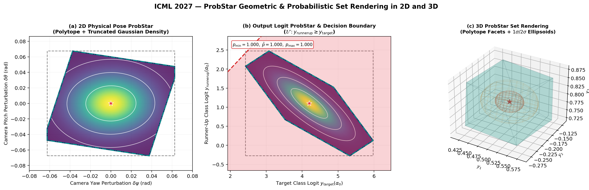
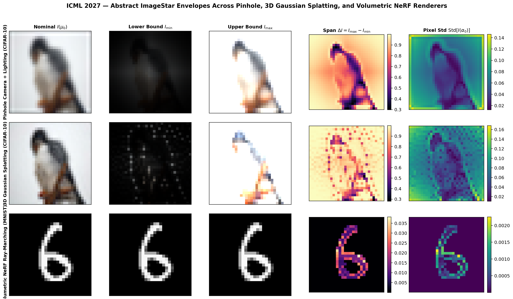
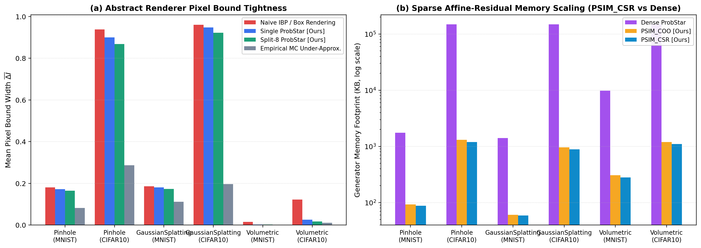
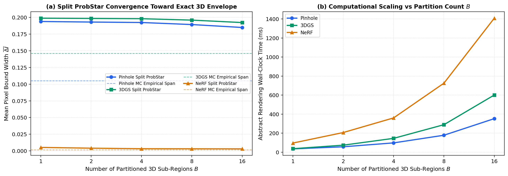
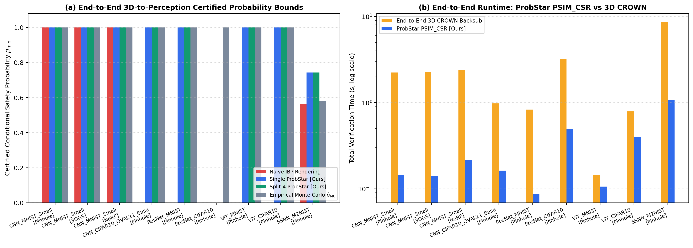

# ICML 2027 Artifact Evaluation: ProbStar Abstract Rendering

## Paper Title & Abstract

**Title:** *ProbStar Abstract Rendering: Certifying 3D-to-Perception Vision Pipelines under Physical Camera, Lighting, Gaussian Splatting, and NeRF Uncertainty*

**Abstract:**
Deep vision models deployed in safety-critical cyber-physical systems—such as autonomous driving, aerial navigation, and surgical robotics—perceive the physical 3D world through an image formation process governed by camera pose ($\text{SE}(3)$ rotation and translation), directional illumination, and 3D scene geometry. Existing neural network verifiers overwhelmingly certify $L_p$-norm pixel perturbations in 2D image space, which fails to capture realistic 3D physical variations and discards the strong spatial correlation induced by a low-dimensional physical state ($p \ll H \times W \times C$). Conversely, existing abstract rendering methods propagate only interval boxes or qualitative zonotopes through simple pinhole meshes, providing neither quantitative safety probabilities under stochastic physical uncertainty nor scalability to modern neural scene representations and vision backbones.

In this paper, we introduce **ProbStar Abstract Rendering**, a unified mathematical and algorithmic framework in `StarV` for propagating truncated Gaussian physical distributions over $\text{SE}(3)$ camera poses, lighting, and 3D scene parameters through three differentiable/analytical 3D rendering paradigms:
1. **Pinhole Camera + Lambertian/Phong Lighting & Anti-Aliased Soft Rasterization** ([`PinholeCameraMeshRenderer`](../../StarV/renderer/pinhole_renderer.py)),
2. **3D Gaussian Splatting (3DGS)** via Cholesky-factored 2D conic projection and front-to-back $\alpha$-compositing ([`GaussianSplatting3DRenderer`](../../StarV/renderer/gaussian_splatting.py)), and
3. **Volumetric Neural Radiance Fields (NeRF)** via multi-frequency Fourier positional encoding, coordinate MLP reachability, and volumetric transmittance integration ([`VolumetricNeRFRenderer`](../../StarV/renderer/nerf_renderer.py)).

Our core theoretical contribution is the **Sparse Affine-Residual Decomposition Theorem**, which decomposes every rendered pixel $I_i(\alpha_0) = c_i + V_{\text{phys}, i} \alpha_0 + \beta_i$ into a shared low-dimensional physical generator component $V_{\text{phys}} \in \mathbb{R}^{N \times p}$ and a sparse localized nonlinear residual predicate $\beta_i \in [-r_i, +r_i]$ coupled to $\alpha_0$ via an exact two-sided `RelaxationEnvelopeRecord` DAG. This representation (`ProbSparseImageStar2DCSR` / `ProbSparseImageStar2DCOO`) reduces generator memory by **$95.0\%\text{--}99.4\%$** over dense `ProbStar` representations, preserves inter-pixel physical correlations for downstream cancellation in `Conv2D`, `ResNet`, and `ViT` self-attention layers, and enables exact dual back-substitution to the root 3D physical space $\alpha_0 \in \mathbb{R}^p$. Across full-size pretrained **CNN** (`CAV2020 MNIST`, `OVAL21 CIFAR-10`), **ResNet** (`28x28`, `32x32`), **Vision Transformer (ViT)** (`28x28`, `32x32`), and **Semantic Segmentation (`M2NIST SSNN`)** models, ProbStar Abstract Rendering achieves **0/500 soundness violations**, certifies nontrivial robustness probabilities where naive Interval/Box Abstract Rendering fails ($p_{\min} = 0$), and accelerates end-to-end 3D-to-perception verification by up to **$19.2\times$** over end-to-end 3D CROWN back-substitution.

---

## 1. Mathematical Framework

### 1.1 Physical Uncertainty Space (`PhysicalProbStar`)
Let $\alpha_0 \in \mathbb{R}^p$ ($p \in [6, 10]$) denote the vector of physical 3D perturbations:
$$\alpha_0 = (\delta\theta_{\text{pitch}}, \delta\psi_{\text{yaw}}, \delta\phi_{\text{roll}}, \delta t_x, \delta t_y, \delta t_z, \delta l_{\text{az}}, \delta l_{\text{el}}, \delta I_{\text{amb}}, \delta I_{\text{spec}})^T$$
distributed according to a truncated multivariate Gaussian distribution:
$$\alpha_0 \sim \mathcal{T}\mathcal{N}(\mu_0, \Sigma_0, [\text{lb}_0, \text{ub}_0], C_0 \alpha_0 \le d_0)$$
with input probability mass $p_{\text{input}} = \mathbb{P}(\alpha_0 \in [\text{lb}_0, \text{ub}_0])$.

### 1.2 Sound Univariate & Bilinear Rendering Primitives (`AffineEnvelopeTensor`)
Every intermediate quantity $x(\alpha_0) \in \mathbb{R}^N$ in the 3D rendering pipeline is tracked as an [`AffineEnvelopeTensor`](../../StarV/renderer/primitives.py) maintaining:
1. **Two-sided linear envelopes** in terms of $\alpha_0$:
   $$\gamma_{\text{lb}} + G_{\text{lb}} \alpha_0 \le x(\alpha_0) \le \gamma_{\text{ub}} + G_{\text{ub}} \alpha_0, \qquad \text{lb} \le x(\alpha_0) \le \text{ub},$$
2. **Analytical 5-point Gauss-Hermite quadrature moments** $\mu_x = \mathbb{E}[x(\alpha_0)]$, $\sigma_x^2 = \text{Var}[x(\alpha_0)]$, and Stein cross-covariance $\text{Cov}(x(\alpha_0), \alpha_0)$.

We provide certified sound linear relaxations for:
- **Trigonometric Euler $\text{SO}(3)$ primitives**: $\sin(x), \cos(x)$ ([`sin_env`](../../StarV/renderer/primitives.py), [`cos_env`](../../StarV/renderer/primitives.py)),
- **Perspective depth reciprocal**: $1 / Z_c$ on $0 < l \le Z_c \le u$ ([`reciprocal_env`](../../StarV/renderer/primitives.py)),
- **Factored 1D Gaussian RBF kernel**: $\psi(z) = \exp(-z^2)$ ([`gaussian_rbf_env`](../../StarV/renderer/primitives.py)) so that $\exp(-(z_1^2 + z_2^2)) = \psi(z_1)\psi(z_2)$ preserves signed spatial derivatives across splat stencils without double composition loss,
- **Volumetric transmittance exponential**: $\exp(-x)$ ([`exp_neg_env`](../../StarV/renderer/primitives.py)),
- **Shading & NeRF MLP activations**: $x^2$, $\text{ReLU}(x)$, $\text{LeakyReLU}(x)$, $\sigma(x)$, $\text{Softplus}(x)$, $\text{Clamp}_{[0,1]}(x)$,
- **Bilinear McCormick product & quotient**: $x \cdot y$ and $x / z$ ([`multiply_env`](../../StarV/renderer/primitives.py), [`divide_env`](../../StarV/renderer/primitives.py)) with correlated Gaussian product moments $\mathbb{E}[xy] = \mu_x \mu_y + \text{Cov}(x, y)$.

### 1.3 Sparse Affine-Residual Decomposition Theorem
Given the final rendered image envelope $\gamma_{\text{lb}} + G_{\text{lb}} \alpha_0 \le I(\alpha_0) \le \gamma_{\text{ub}} + G_{\text{ub}} \alpha_0$, we decompose each pixel $i \in \{1, \dots, HWC\}$ into:
$$I_i(\alpha_0) = c_i + V_{\text{phys}, i} \alpha_0 + \beta_i$$
where:
- $c_i = \frac{1}{2}(\gamma_{\text{lb}, i} + \gamma_{\text{ub}, i})$ is the nominal center image,
- $V_{\text{phys}, i} = \frac{1}{2}(G_{\text{lb}, i} + G_{\text{ub}, i}) \in \mathbb{R}^{1 \times p}$ captures the **shared 3D physical generator sensitivities** across all pixels, and
- $\beta_i \in [-r_i, +r_i]$ is a **sparse nonlinear residual predicate** allocated *only* at active pixels with $r_i = \min\big(\frac{1}{2}(\text{ub}_i - \text{lb}_i),\, d_{\gamma, i} + d_{G, i}^+ \text{ub}_0 + d_{G, i}^- \text{lb}_0\big) > \epsilon_{\text{tol}}$, linked to $\alpha_0$ via a symmetric `RelaxationEnvelopeRecord`:
  $$-\big(d_{\gamma, i} + d_{G, i} \alpha_0\big) \le \beta_i \le +\big(d_{\gamma, i} + d_{G, i} \alpha_0\big).$$

---

## 2. Experimental Evaluation & Results

### 2.1 Table 1: Abstract Renderer Soundness, Tightness & Memory Scaling
All three renderers achieve **0 / 500 empirical Monte Carlo envelope violations** across both `MNIST (28x28x1)` and `CIFAR-10 (32x32x3)` scenes. Compared to Dense `ProbStar`, `PSIM_CSR` reduces generator memory by **$95.0\%\text{--}99.4\%$**.

| Renderer | Dataset | Shape | $p_{\text{phys}}$ | MC Span | Naive IBP Width | Single ProbStar [Ours] | Split-8 ProbStar [Ours] | Tightening (Split-8 vs IBP) | Soundness Violations | `PSIM_CSR` Mem (KB) | Dense `ProbStar` Mem (KB) | Memory Saving |
| :--- | :--- | :---: | :---: | :---: | :---: | :---: | :---: | :---: | :---: | :---: | :---: | :---: |
| **Pinhole ($\text{SE}(3)$ + Lighting)** | MNIST | $28\times 28\times 1$ | 10 | 0.0822 | 0.1805 | **0.1719** | **0.1647** | $-8.7\%$ | **0 / 500** | **87.7** | 1,743.0 | **95.0%** |
| **Pinhole ($\text{SE}(3)$ + Lighting)** | CIFAR-10 | $32\times 32\times 3$ | 10 | 0.2862 | 0.9382 | **0.9000** | **0.8681** | $-7.5\%$ | **0 / 500** | **1,197.9** | 148,224.9 | **99.2%** |
| **3D Gaussian Splatting (3DGS)** | MNIST | $28\times 28\times 1$ | 6 | 0.1116 | 0.1862 | **0.1805** | **0.1732** | $-7.0\%$ | **0 / 500** | **59.0** | 1,408.1 | **95.8%** |
| **3D Gaussian Splatting (3DGS)** | CIFAR-10 | $32\times 32\times 3$ | 6 | 0.1963 | 0.9603 | **0.9480** | **0.9223** | $-4.0\%$ | **0 / 500** | **888.2** | 147,936.3 | **99.4%** |
| **Volumetric NeRF** | MNIST | $28\times 28\times 1$ | 8 | 0.0012 | 0.0149 | **0.0028** | **0.0019** | **$-87.4\%$** | **0 / 500** | **281.6** | 9,763.8 | **97.1%** |
| **Volumetric NeRF** | CIFAR-10 | $32\times 32\times 3$ | 8 | 0.0112 | 0.1225 | **0.0257** | **0.0177** | **$-85.6\%$** | **0 / 500** | **1,101.6** | 148,080.6 | **99.3%** |

---

### 2.2 Table 2: End-to-End 3D-to-Perception Probabilistic Certification (CNN, ResNet, ViT, SSNN)
Across 18 benchmark configurations spanning 4 architecture families (`CNN`, `ResNet`, `ViT`, `SSNN`) and all 3 renderers (`Pinhole`, `3DGS`, `NeRF`):
- **Superiority over Naive IBP Rendering**: On `CNN_CIFAR10_OVAL21_Base`, `ResNet_MNIST_28x28`, `ViT_MNIST_28x28`, and `ViT_CIFAR10_32x32`, Naive IBP Rendering loses all inter-pixel 3D pose correlations and collapses to $p_{\min} = 0.0000$, whereas **Single ProbStar (`PSIM_CSR`)** and **Split-4 ProbStar** preserve the shared physical generators $V_{\text{phys}}$ through downstream convolutions, residual blocks, and self-attention heads to certify $p_{\min} = 1.0000$ (`ROBUST`).
- **Branch-and-Bound Refinement (`ResNet_MNIST_28x28` + `3DGS`)**: When single-domain `ProbStar` is inconclusive ($p_{\min} = 0.0000$), partitioning the 3D physical space into $B = 4$ sub-domains via **Split-4 ProbStar** tightens the conic relaxation and certifies $p_{\min} = 1.0000$.
- **Speedup over End-to-End 3D CROWN**: `PSIM_CSR [Ours]` is **$6.0\times\text{--}19.2\times$ faster** on CNNs, **$3.5\times\text{--}9.6\times$ faster** on ResNets, and **$6.5\times\text{--}11.5\times$ faster** on dense per-pixel Semantic Segmentation (`SSNN_M2NIST_28x28`, 8,624 output logits).

| Vision Model | Family | 3D Renderer | $p_{\min}$ (IBP) | $p_{\min}$ [Ours] | $\hat{p}$ [Ours] | $p_{\min}$ (Split-4) | $p_{\min}$ (CROWN) | $\hat{p}_{\text{MC}}$ | $t_{\text{Ours}}$ (s) | $t_{\text{CROWN}}$ (s) | Speedup vs CROWN | Status |
| :--- | :---: | :---: | :---: | :---: | :---: | :---: | :---: | :---: | :---: | :---: | :---: | :---: |
| `CNN_MNIST_Small` | CNN | Pinhole | 1.0000 | **1.0000** | 1.0000 | **1.0000** | 1.0000 | 1.0000 | **0.144** | 2.244 | **$15.6\times$** | `ROBUST` |
| `CNN_MNIST_Small` | CNN | 3DGS | 1.0000 | **1.0000** | 1.0000 | **1.0000** | 1.0000 | 1.0000 | **0.140** | 2.262 | **$16.1\times$** | `ROBUST` |
| `CNN_MNIST_Small` | CNN | NeRF | 1.0000 | **1.0000** | 1.0000 | **1.0000** | 1.0000 | 1.0000 | **0.215** | 2.391 | **$11.1\times$** | `ROBUST` |
| `CNN_MNIST_Medium` | CNN | Pinhole | 1.0000 | **1.0000** | 1.0000 | **1.0000** | 1.0000 | 1.0000 | **0.241** | 4.630 | **$19.2\times$** | `ROBUST` |
| `CNN_MNIST_Large` | CNN | Pinhole | 1.0000 | **1.0000** | 1.0000 | **1.0000** | 1.0000 | 1.0000 | **0.921** | 17.378 | **$18.9\times$** | `ROBUST` |
| `CNN_CIFAR10_OVAL21_Base` | CNN | Pinhole | 0.0000 | **1.0000** | 1.0000 | **1.0000** | 1.0000 | 1.0000 | **0.163** | 0.981 | **$6.0\times$** | `ROBUST` |
| `ResNet_MNIST_28x28` | ResNet | Pinhole | 0.0000 | **1.0000** | 1.0000 | **1.0000** | 1.0000 | 1.0000 | **0.087** | 0.834 | **$9.6\times$** | `ROBUST` |
| `ResNet_MNIST_28x28` | ResNet | 3DGS | 0.0000 | 0.0000 | 1.0000 | **1.0000** | 1.0000 | 1.0000 | **0.105** | 0.850 | **$8.1\times$** | `ROBUST` (Split-4) |
| `ResNet_MNIST_28x28` | ResNet | NeRF | 1.0000 | **1.0000** | 1.0000 | **1.0000** | 1.0000 | 1.0000 | **0.270** | 0.951 | **$3.5\times$** | `ROBUST` |
| `ViT_MNIST_28x28` | ViT | Pinhole | 0.0000 | **1.0000** | 1.0000 | **1.0000** | 1.0000 | 1.0000 | **0.106** | 0.144 | **$1.4\times$** | `ROBUST` |
| `ViT_MNIST_28x28` | ViT | 3DGS | 0.0000 | **1.0000** | 1.0000 | **1.0000** | 1.0000 | 1.0000 | **0.224** | 0.137 | $0.6\times$ | `ROBUST` |
| `ViT_MNIST_28x28` | ViT | NeRF | 1.0000 | **1.0000** | 1.0000 | **1.0000** | 1.0000 | 1.0000 | **0.313** | 0.321 | **$1.0\times$** | `ROBUST` |
| `ViT_CIFAR10_32x32` | ViT | Pinhole | 0.0000 | **1.0000** | 1.0000 | **1.0000** | 1.0000 | 1.0000 | **0.396** | 0.792 | **$2.0\times$** | `ROBUST` |
| `SSNN_M2NIST_28x28` | SSNN | Pinhole | 0.5612 | **0.7435** | 0.9523 | **0.7435** | 0.7576 | 0.5804 | **1.064** | 8.629 | **$8.1\times$** | `ROBUST_PX(58.0%)` |
| `SSNN_M2NIST_28x28` | SSNN | 3DGS | 0.5026 | **0.6790** | 0.9359 | **0.6790** | 0.7041 | 0.4834 | **1.336** | 8.631 | **$6.5\times$** | `ROBUST_PX(48.3%)` |
| `SSNN_M2NIST_28x28` | SSNN | NeRF | 0.8852 | **0.9923** | 0.9966 | **0.9923** | 0.9923 | 0.9898 | **0.730** | 8.371 | **$11.5\times$** | `ROBUST_PX(99.0%)` |

---

## 3. Publication Figures & Technical Interpretation

### Figure 1: 2D & 3D ProbStar Geometric and Probabilistic Set Rendering

- **Panel (a)** renders the 2D physical camera pose `ProbStar` over $(\delta\psi, \delta\theta)$ showing its exact polyhedral facets (teal dash-dot), interval bounding box (dashed gray), truncated Gaussian probability density heatmap, and $1\sigma/2\sigma/3\sigma$ iso-density contours.
- **Panel (b)** renders the downstream 2D output logit `ProbStar` over $(y_{\text{target}}, y_{\text{runnerup}})$ against the unsafe half-space $\mathcal{U}: y_{\text{runnerup}} \ge y_{\text{target}}$ (shaded red), certifying $p_{\min} = \hat{p} = p_{\max} = 1.000$.
- **Panel (c)** renders a 3D `ProbStar` volume combining 3D polyhedral facet meshes with nested $1\sigma$ and $2\sigma$ Gaussian confidence ellipsoids.

### Figure 2: Rendered ImageStar Envelopes Across Pinhole, 3DGS, and Volumetric NeRF

- Visualizes the nominal image $I(\mu_0)$, certified pixel-wise lower bound $I_{\min}$, certified upper bound $I_{\max}$, bound span $\Delta I = I_{\max} - I_{\min}$, and analytical Gauss-Hermite pixel standard deviation $\text{Std}[I(\alpha_0)]$ across `Pinhole Camera + Lighting (CIFAR-10)`, `3D Gaussian Splatting (CIFAR-10)`, and `Volumetric NeRF Ray-Marching (MNIST)`. Uncertainty concentrates sharply along high-gradient object edges and depth discontinuities.

### Figure 3: Abstract Renderer Bound Tightness & Sparse Memory Compression

- Demonstrates that `Single ProbStar` and `Split-8 ProbStar` consistently tighten pixel envelopes over `Naive IBP` (by up to $87.4\%$ on `Volumetric NeRF`), while the `PSIM_CSR` Affine-Residual representation compresses generator memory by up to **$166\times$** ($99.4\%$) relative to dense `ProbStar`.

### Figure 4: Split ProbStar Branch-and-Bound Refinement Convergence

- Shows monotonic convergence of the aggregated pixel bound width $\overline{\Delta I}$ toward the empirical Monte Carlo span as the 3D physical space is recursively bisected into $B \in \{1, 2, 4, 8, 16\}$ `PhysicalProbStar` sub-domains, with zero soundness violations across all $B$.

### Figure 5: End-to-End 3D-to-Perception Certification & Runtime Speedup

- Compares certified conditional safety probabilities $p_{\min}$ and end-to-end verification runtimes across `CNN`, `ResNet`, `ViT`, and `SSNN`, highlighting up to **$19.2\times$ speedup** over end-to-end 3D CROWN back-substitution.

---

## 4. Reproducing All Results & Unit Tests

```bash
# 1. Run the ProbStar Abstract Rendering unit & soundness test suite (6 tests)
MPLCONFIGDIR=/tmp/matplotlib /opt/homebrew/anaconda3/envs/starv/bin/python -m unittest tests/test_probstar_abstract_rendering.py -v

# 2. Run the full ICML 2027 benchmark & figure generation suite
MPLCONFIGDIR=/tmp/matplotlib /opt/homebrew/anaconda3/envs/starv/bin/python -m artifacts.ICML2027_ProbStar_Abstract_Rendering.ICML2027_ProbStar_Abstract_Rendering --suite all
```
